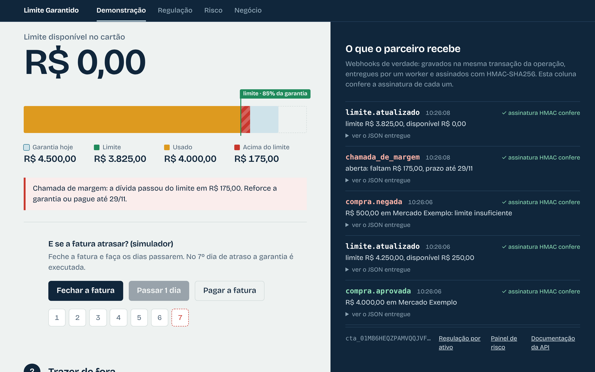
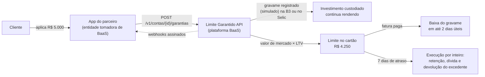
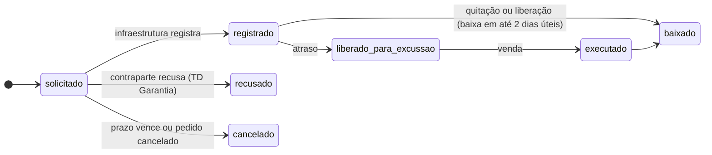
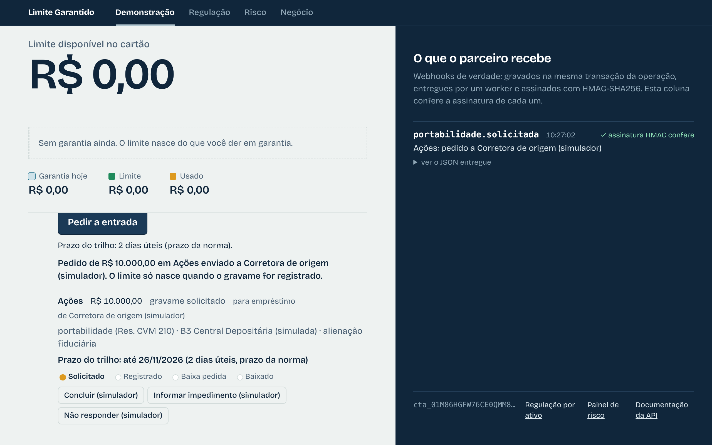
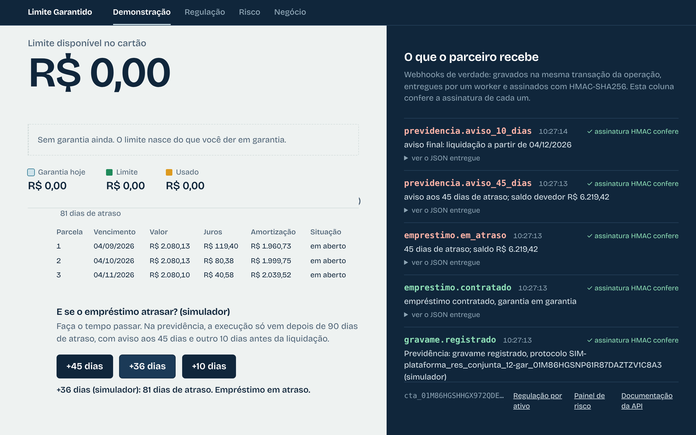
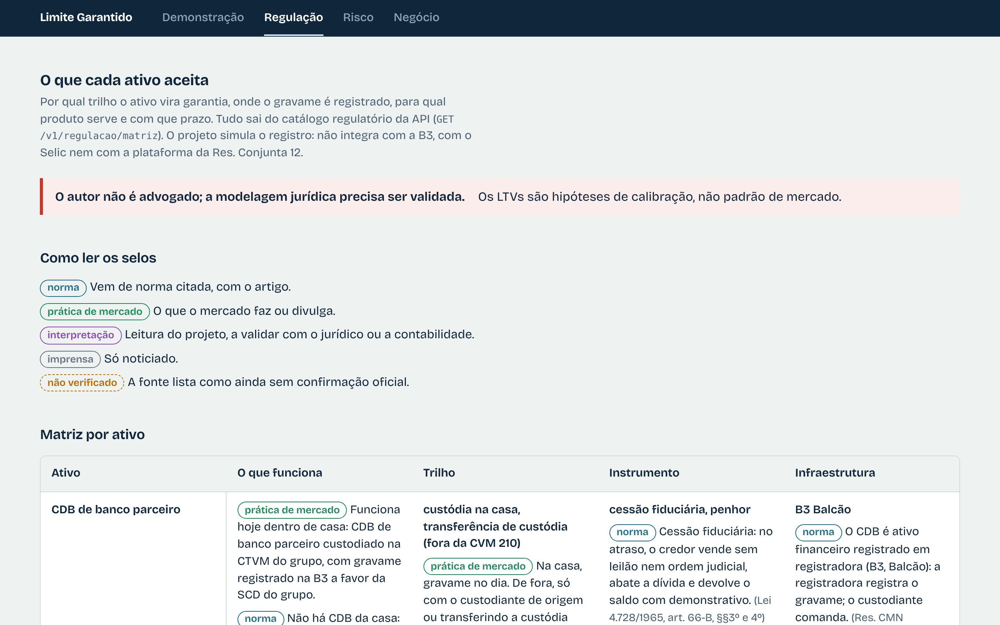
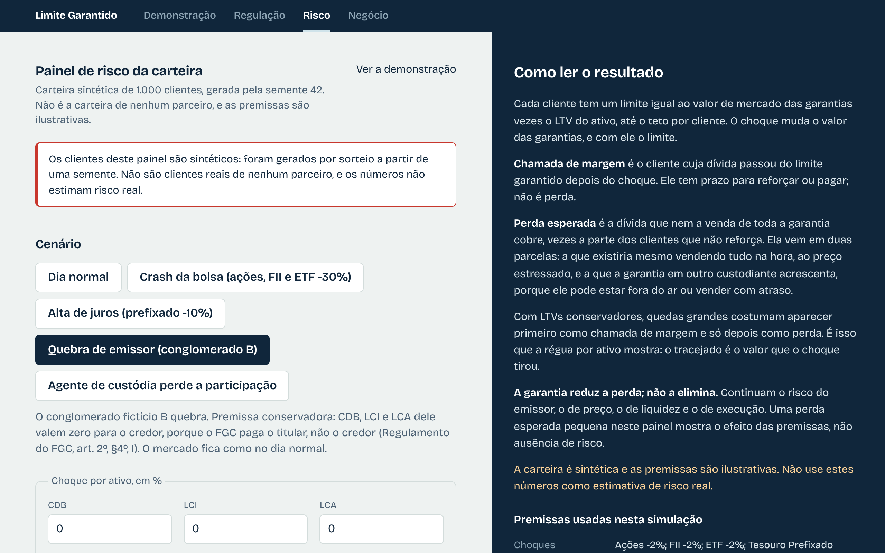
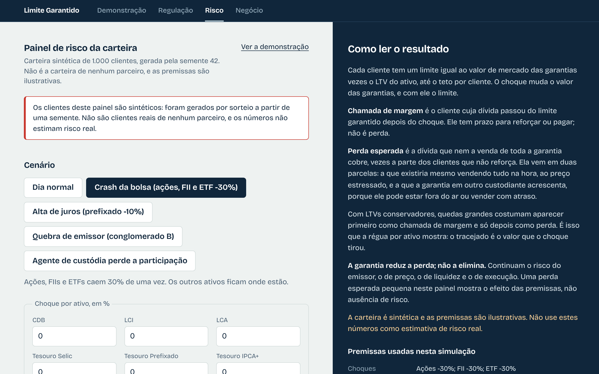

# Limite Garantido as a Service

Uma API para transformar o investimento do cliente em limite no cartão, pensada para
uma plataforma de Banking as a Service oferecer a parceiros que não são banco.

> **Projeto pessoal de estudo.** Foi feito só com informação pública, não é um produto
> real e não tem vínculo com nenhuma instituição. Não sou advogado: a modelagem jurídica
> precisa ser validada por quem é.



## O problema

Hoje o seu investimento só vira garantia de crédito na instituição onde ele está
custodiado. Limite garantido já é um produto provado no varejo: vários bancos e fintechs
deixam você reservar um valor e usar como limite no cartão. Mas todos fazem isso com o
ativo do próprio grupo, para o cliente do próprio grupo (levantamento em
[docs/mercado.md](docs/mercado.md), com fonte e categoria de cada afirmação).

Quem não é banco (uma fintech, um varejista, uma carteira digital) não consegue
oferecer o mesmo. O cliente dela resgata o investimento, paga juro alto ou fica sem
limite.

## A ideia

A plataforma faz o trabalho difícil uma vez, para todos os parceiros. O parceiro só
chama a API e é, para o regulador, uma entidade tomadora de BaaS: quem concede o crédito
e emite o cartão é a instituição autorizada (uma SCD do grupo, por exemplo).



1. O dinheiro do cliente fica num investimento custodiado, que continua rendendo.
2. O gravame é registrado na registradora ou no depositário central (a B3 ou o Selic;
   aqui, simulado). O custodiante comanda; a infraestrutura registra.
3. O limite só nasce com o gravame registrado e vale `valor de mercado × LTV`,
   arredondado para baixo. O LTV depende do ativo e da faixa do catálogo: por exemplo,
   85% a 95% para CDB e fundo DI, 90% a 95% para Tesouro Selic. Ações, FIIs, ETFs, LCI,
   LCA e previdência só entram no empréstimo, não no cartão.
4. Se o ativo cai e a dívida passa do limite, abre uma chamada de margem com prazo.
5. Se a fatura é paga, o gravame recebe a baixa. Se atrasa, no 7º dia a garantia é
   executada por inteiro: o ativo é vendido ou resgatado, quem paga o rendimento retém o
   tributo, o líquido abate a dívida e o excedente volta ao cliente com demonstrativo.

O caminho em fases e o desenho do piloto estão em [docs/roadmap.md](docs/roadmap.md). A
base regulatória, ativo por ativo, está em [docs/regulacao.md](docs/regulacao.md) e na
página `/regulacao`.

## Trilhos de fora do grupo (simulados)

O investimento nem sempre está dentro de casa. Cada tipo de ativo tem o seu caminho
(trilho), e **todos são simulados aqui**: não há integração com a B3, com o Selic, com a
plataforma da Res. Conjunta 12 nem com instituição alguma. As contrapartes são
personagens fictícios, marcados como simulador, com comportamento configurado em
[`app/contrapartes_simuladas.toml`](app/contrapartes_simuladas.toml).

| Trilho | Para quê | Rota |
|---|---|---|
| Custódia na casa | Ativo já custodiado na CTVM do grupo; gravame no mesmo dia | `POST /v1/contas/{id}/garantias` |
| Portabilidade (Res. CVM 210) | Ações, FIIs, ETFs e cotas de fundos de outra instituição | `POST /v1/contas/{id}/portabilidades` |
| Transferência de custódia | CDB, LCI e LCA (fora da CVM 210) | `POST /v1/contas/{id}/transferencias-de-custodia` |
| TD Garantia | Tesouro Direto, com o agente de custódia do cliente | `POST /v1/contas/{id}/garantias/tesouro` |
| Res. Conjunta 12 | Previdência (PGBL e VGBL), só empréstimo | `POST /v1/contas/{id}/garantias/previdencia` |

Nem todo ativo tem trilho de fora: **investimento de outra instituição não é aceito para
qualquer ativo**, e a matriz em `/regulacao` diz o que cada um aceita. CDB, LCI e LCA, por
exemplo, só entram por transferência de custódia, e o COE não é recomendado como
garantia.



- O limite só nasce depois de `registrado`. Recusa e cancelamento não lançam nada no
  ledger e avisam o parceiro por webhook.
- A resposta da contraparte chega por callback assinado (HMAC-SHA256, com janela contra
  reapresentação) ou pela consulta que o worker faz. A mesma resposta, venha por onde
  vier, é aplicada uma vez só.
- Prazos regulatórios contam em dias úteis, pelo calendário nacional em
  [`app/feriados_nacionais.toml`](app/feriados_nacionais.toml). Contraparte que passa do
  prazo gera `garantia.prazo_regulatorio_vencido`.
- Na previdência, a execução só ocorre depois de 90 dias de atraso, com avisos de 45 e de
  10 dias (Res. Conjunta 12, arts. 6º e 12); o valor já entra líquido de tributos.

| O que é real | O que é simulado |
|---|---|
| Máquinas de estado do gravame, regras de limite, ledger e chamada de margem | A B3, o Selic, a plataforma da Res. Conjunta 12 e as contrapartes |
| A rota de callback, a assinatura, a janela contra replay e a idempotência | O tempo de resposta e a chance de recusa (perfis fictícios) |
| A rotina que envia, consulta, baixa e concilia, no worker | O preço obtido na venda da garantia |
| Os webhooks para o parceiro | Os botões de simulador do `/demo` (sandbox) |
| O catálogo regulatório, a matriz e as páginas gerados dele | A carteira de 1.000 clientes do `/risco` e as premissas dos cenários |



A régua da previdência (avisos de 45 e de 10 dias, execução só após 90 dias de atraso):



Onde entrariam os trilhos reais está em
[docs/arquitetura.md](docs/arquitetura.md#onde-entraria-o-trilho-real).

A matriz regulatória, ativo por ativo, com a categoria de cada afirmação:



## Empréstimo com garantia

Além do cartão, a API contrata um empréstimo parcelado com garantia
(`POST /v1/contas/{id}/emprestimos`): juros, parcelas, pagamento por parcela, régua de
atraso e execução. É o único caminho de ações, FIIs, ETFs, LCI, LCA e previdência. O
mínimo está descrito na decisão 81 de [docs/DECISOES.md](docs/DECISOES.md); crédito PJ,
agente de garantia e execução parcial ficam em "Próximos passos".

## Painel de risco da carteira

Em `/risco`, uma carteira **sintética** de 1.000 clientes (cartão e empréstimo; CDB,
fundo DI, Tesouro, ações, previdência, entre outros, parte com garantia fora de casa)
passa por um choque. Cinco cenários prontos: dia normal, crash da bolsa (ações, FIIs e
ETFs −30%), alta de juros (prefixado −10%), quebra de emissor e agente que perde a
participação. A tela mostra clientes em chamada de margem, limite antes e depois, a perda
esperada separando o que está fora de casa, a concentração por onde está o ativo e por
conglomerado contra o teto do FGC, o haircut por classe e prazo e a carteira de provisão.
**A garantia reduz a perda; restam o risco do emissor, de preço, de liquidez e de
execução.** A carteira é gerada da mesma semente, e as premissas são ilustrativas.





## Rodando em 3 comandos

**Com Docker** (Postgres, migrações, API e worker de webhooks):

```bash
git clone https://github.com/EnzoRenato16/limite-garantido-api.git
cd limite-garantido-api
docker compose up --build
```

Depois abra <http://localhost:8000/demo> (a demonstração),
<http://localhost:8000/risco> (o painel de risco),
<http://localhost:8000/negocio> (o modelo econômico),
<http://localhost:8000/regulacao> (a matriz regulatória) ou
<http://localhost:8000/docs> (a documentação da API).

**Sem Docker**, com [uv](https://docs.astral.sh/uv/):

```bash
uv sync                  # instala as dependências
uv run python demo.py    # a história inteira no terminal, sem configurar nada
./scripts/dev.sh         # sobe API e worker em SQLite; abra /demo, /risco, /negocio e /regulacao
```

O `demo.py` roda a API de verdade dentro do processo e conta a história de um cliente:

```text
1. O cliente aplica R$ 5.000 em CDB custodiado na casa
   LTV do CDB na política deste parceiro: 85%. Limite liberado: R$ 4.250,00
   garantia ████████████████████████████████████████████  R$ 5.000,00
   limite   █████████████████████████████████████░░░░░░░  R$ 4.250,00
   usado    ░░░░░░░░░░░░░░░░░░░░░░░░░░░░░░░░░░░░░░░░░░░░  R$ 0,00

4. O CDB cai 10% na marcação a mercado
   garantia ████████████████████████████████████████░░░░  R$ 4.500,00
   limite   ██████████████████████████████████░░░░░░░░░░  R$ 3.825,00
   usado    ███████████████████████████████████░░░░░░░░░  R$ 4.000,00
   disponível para comprar: R$ 0,00   dívida acima do limite: R$ 175,00

5. A fatura fecha e não é paga
   03/03  dia 1  fatura em atraso: novas compras suspensas
   08/03  dia 6  prazo da chamada de margem esgotado: conta bloqueada
   09/03  dia 7  7º dia de atraso: a garantia é executada
   Vendida a garantia inteira (R$ 4.500,00); R$ 4.000,00 quitam a fatura e R$ 500,00 voltam ao cliente.
```

## O que tem aqui

| Tema | O que foi feito |
|---|---|
| **Domínio** | Regras de crédito puras, sem banco e sem framework. Dinheiro em centavos inteiros, nunca `float`. Gravame com máquina de estados própria, separada da garantia. |
| **Catálogo regulatório** | `app/regulacao.toml` é a fonte única: por ativo, trilho, infraestrutura, instrumento, produto, prazo, norma e artigo, cada afirmação com categoria. Gera a página `/regulacao`, `GET /v1/regulacao/matriz` e `docs/regulacao.md`. |
| **Ledger** | Partidas dobradas. Não existe campo de saldo: dívida e valor de garantia são somas do ledger. No Postgres, gatilhos tornam o ledger somente inserção e recusam lançamento que não fecha. |
| **Concorrência** | Trava de linha e versão otimista. Um teste dispara 40 compras simultâneas contra Postgres e exige que passem exatamente as que cabem. |
| **API** | Multi-tenant (API key por parceiro, só o hash no banco), idempotência persistida, erros RFC 7807 com códigos estáveis, paginação por cursor, rate limit, OpenAPI em português. |
| **Webhooks** | Outbox na mesma transação, worker com assinatura HMAC-SHA256 e timestamp, backoff exponencial, dead letter e reenvio manual. |
| **Risco** | Marcação a mercado, chamada de margem com prazo, tetos por cliente e por parceiro, haircut por prazo, FGC, provisão, simulador de stress e o painel `/risco` sobre carteira sintética. |
| **Trilhos (simulados)** | Portabilidade, transferência de custódia, TD Garantia e previdência com contrapartes fictícias, callback assinado, baixa em até 2 dias úteis e conciliação diária. |
| **Empréstimo** | Parcelado com garantia, juros pro rata, régua de atraso e a régua da previdência (45, 10 e 90 dias). |
| **Operação** | Logs JSON com `request_id` e `parceiro_id`, `/health`, `/metrics` para Prometheus. |
| **Modelo econômico** | A página `/negocio` e a API `/v1/negocio`: margem da plataforma e do parceiro por cliente, ponto de equilíbrio, dentro de casa x de fora e tornado, com premissas ilustrativas. |
| **Demonstração** | `demo.py` no terminal e as páginas `/demo`, `/regulacao`, `/risco` e `/negocio`, testadas de ponta a ponta com Playwright. |

## Modelo econômico (`/negocio`)

Em `/negocio`, quanto a plataforma e o parceiro ganham por cliente ativo por mês, a partir
de quantos clientes a plataforma paga o custo fixo, quanto a garantia de fora de casa
custa a mais que a de dentro e quais premissas mais mexem no resultado (tornado). Três
conjuntos prontos (conservador, base, otimista) e controles para editar os valores. O
IOF do crédito aparece à parte, repassado ao governo, fora das margens.

Para abrir, é o mesmo caminho do `/risco`: com a aplicação no ar,
<http://localhost:8000/negocio>.

**Os números são ilustrativos**: premissas editáveis, sem dado de nenhuma empresa. No
conjunto base (com quebra de emissor), a plataforma fica com cerca de R$ 4,10 por cliente
por mês, o parceiro com R$ 4,79 e o equilíbrio vem em 97.561 clientes, numa carteira de
100.000; a garantia de fora de casa custa R$ 1,73 por cliente por mês a mais. São
resultado de premissas inventadas, não previsão. Só têm fonte o CDI, os tetos de
intercâmbio e do rotativo e a taxa média do rotativo; o resto é "premissa ilustrativa". A
conta, as premissas com faixa e origem e as fontes estão em
[docs/economia.md](docs/economia.md).


O conjunto conservador mostra margem negativa e nenhum ponto de equilíbrio, de propósito:
com premissas ruins, o negócio não se sustenta.

## Endpoints

A lista completa, com exemplos, está em `/docs` com a API no ar. Os principais:

| Método | Caminho | Para quê |
|---|---|---|
| `POST` | `/v1/contas` | Abrir a conta de um cliente do parceiro |
| `GET` | `/v1/contas/{id}` | Conta, posição de limite, fatura em aberto e chamada de margem |
| `POST` | `/v1/contas/{id}/garantias` | Registrar o gravame de um ativo custodiado na casa ¹ |
| `POST` | `/v1/contas/{id}/portabilidades` | Trazer ações, FIIs, ETFs ou fundos de outra instituição (CVM 210) ¹ |
| `POST` | `/v1/contas/{id}/transferencias-de-custodia` | Trazer CDB, LCI ou LCA por transferência de custódia ¹ |
| `POST` | `/v1/contas/{id}/garantias/tesouro` | Tesouro Direto pelo TD Garantia ¹ |
| `POST` | `/v1/contas/{id}/garantias/previdencia` | Previdência pela Res. Conjunta 12 (só empréstimo) ¹ |
| `POST` | `/v1/contas/{id}/emprestimos` | Contratar um empréstimo parcelado com garantia ¹ |
| `GET` | `/v1/emprestimos/{id}` | Empréstimo, parcelas e saldo devedor |
| `POST` | `/v1/emprestimos/{id}/pagamentos` | Pagar parcelas ¹ |
| `POST` | `/v1/garantias/{id}/liberacao` | Pedir a baixa do gravame, se a dívida continuar coberta |
| `POST` | `/v1/contas/{id}/compras` | Autorizar uma compra (`402` se for negada) ¹ |
| `POST` | `/v1/contas/{id}/faturas` | Fechar a fatura |
| `POST` | `/v1/contas/{id}/pagamentos` | Registrar um pagamento ¹ |
| `GET` | `/v1/contas/{id}/lancamentos` | Extrato do ledger |
| `GET` | `/v1/eventos` | Tudo o que aconteceu, com filtros |
| `PUT` | `/v1/parceiro/webhook` | Configurar o webhook e receber o segredo de assinatura |
| `GET` | `/v1/webhooks/entregas` | Entregas, tentativas e dead letter |
| `POST` | `/v1/webhooks/entregas/{id}/reenvio` | Reenviar um webhook |
| `GET` | `/v1/regulacao/matriz` | A matriz regulatória: o que cada ativo aceita, por qual trilho e com que prazo |
| `POST` | `/v1/risco/simulacoes-de-stress` | "E se ações caírem 30%?", na carteira real do parceiro |
| `POST` | `/v1/risco/simulacoes-de-carteira` | O painel de risco, sobre a carteira sintética |
| `GET` | `/v1/risco/cenarios` | Os cinco cenários prontos do painel |
| `GET` | `/v1/negocio/premissas` | Premissas do modelo econômico, com unidade, faixa e origem, e os três conjuntos |
| `POST` | `/v1/negocio/simulacoes` | Margem por cliente, ponto de equilíbrio, dentro x fora de casa e tornado (JSON ou CSV com `Accept: text/csv`) |
| `GET` | `/v1/contrapartes` | Contrapartes aceitas por trilho (todas simuladas) |
| `POST` | `/v1/contrapartes/{id}/callbacks` | Resposta da contraparte, autenticada por assinatura HMAC |
| `GET` | `/v1/erros` | Catálogo dos códigos de erro |
| `POST` | `/v1/sandbox/...` | Simular queda de preço, passagem de dias e a resposta da contraparte (só com o sandbox ligado) |
| `*` | `/v1/admin/...` | Parceiros, políticas, rotinas (marcação, virada do dia, contrapartes, baixas), conciliação e conferência do ledger (uso da plataforma) |

¹ Exige o cabeçalho `Idempotency-Key`.

Um exemplo, com o parceiro de demonstração (a chave é fictícia e está no `.env.example`):

```bash
CHAVE=lgk_exemplo000000_chave-ficticia-so-para-a-demonstracao

curl -s localhost:8000/v1/contas -H "Authorization: Bearer $CHAVE" \
     -H "Content-Type: application/json" -d '{"cliente_ref": "cliente-1"}'

curl -s localhost:8000/v1/contas/<id>/garantias -H "Authorization: Bearer $CHAVE" \
     -H "Content-Type: application/json" -H "Idempotency-Key: $(uuidgen)" \
     -d '{"tipo_ativo": "cdb", "valor": "5000.00", "liquidez_dias": 0}'
```

Eventos enviados por webhook, do cartão: `limite.atualizado`, `compra.aprovada`,
`compra.negada`, `fatura.paga`, `fatura.em_atraso` (uma vez, na entrada em atraso),
`chamada_de_margem`, `garantia.liberada` e `garantia.executada`. Do gravame:
`gravame.solicitado`, `gravame.registrado`, `gravame.recusado`, `gravame.cancelado`,
`gravame.liberado_para_excussao`, `gravame.baixa_pedida` e `gravame.baixado`. Dos trilhos:
`portabilidade.solicitada`, `portabilidade.concluida`, `transferencia.solicitada`,
`transferencia.concluida`, `garantia.prazo_regulatorio_vencido` e, na previdência,
`previdencia.informacoes_recebidas`, `previdencia.aviso_45_dias` e
`previdencia.aviso_10_dias`. Do empréstimo: `emprestimo.contratado`,
`emprestimo.parcela_paga`, `emprestimo.em_atraso` e `emprestimo.quitado`.

## Mudanças

O alinhamento à auditoria regulatória de nov/2026 mexeu em contrato. Quem integrou antes
precisa olhar esta lista.

**Rotas novas:** `/v1/contas/{id}/portabilidades`, `/transferencias-de-custodia`,
`/garantias/tesouro`, `/garantias/previdencia`, `/emprestimos`, `/v1/emprestimos/{id}` (e
`/pagamentos`), `/v1/contrapartes` (e `/{id}/callbacks`), `/v1/regulacao/matriz`, a
página `/regulacao` e, na administração, `/v1/admin/rotinas/baixas`,
`/v1/admin/rotinas/contrapartes` e `/v1/admin/conciliacao`.

**Rotas que respondem `410 Gone`** (com `rota_nova` no problem+json): `GET
/v1/custodiantes`, `POST /v1/custodiantes/{id}/callbacks` e o campo `custodiante_id` de
`POST /v1/contas/{id}/garantias`. O "custodiante externo" deu lugar aos trilhos.

**Eventos novos:** todos os de gravame, de portabilidade, de transferência, de
previdência e de empréstimo listados acima, mais `garantia.prazo_regulatorio_vencido`.

**Eventos renomeados e removidos:**

| Antes | Agora |
|---|---|
| `garantia.bloqueada` | `gravame.registrado` |
| `gravame.confirmado` | `gravame.registrado` |
| `gravame.expirado` | `gravame.cancelado` |
| `liberacao.solicitada`, `liberacao.confirmada`, `liberacao.falhou` | `gravame.baixa_pedida` e `gravame.baixado` |
| `execucao.solicitada`, `execucao.confirmada`, `execucao.falhou` | `gravame.liberado_para_excussao` e `garantia.executada` (com `demonstrativo`) |

**Comportamento:** a execução vende a garantia por inteiro, com retenção do tributo e
devolução do excedente; o tipo `deposito` saiu (virou `cdb` com liquidez diária);
o cartão exige liquidez diária no CDB e até D+1 no fundo DI (campo `liquidez_dias`); combinação de ativo, trilho e
produto que a norma não permite responde `422` com código e sugestão; prazos
regulatórios contam em dias úteis; a política do parceiro é validada contra as faixas do
catálogo. A migração `0003` converte as garantias existentes (mapeamento na decisão 87 de
[docs/DECISOES.md](docs/DECISOES.md)).

**Configuração:** `CUSTODIA_*` saiu. Entram `CONTRAPARTES` (`simulador` ou `desligada`; em
produção o simulador é recusado), `CONTRAPARTES_SEGREDOS` (JSON com o segredo de
callback por contraparte) e `CONTRAPARTES_INTERVALO_SEGUNDOS` (o intervalo da rotina do
worker). Os valores do `.env.example` são fictícios.

## O que o projeto não promete

- **Não integra com a B3, o Selic nem a plataforma da Res. Conjunta 12.** Simula o
  registro de gravame; as contrapartes são fictícias e marcadas como simulador.
- **Investimento de outra instituição não vale para qualquer ativo.** Os trilhos de fora
  são os da tabela acima; para cada ativo, a matriz diz o que existe.
- **INPI.** "Limite Garantido" já é nome de produto de outras instituições. Aqui é
  descrição, não marca: antes de usar como marca, checar o INPI.
- **BaaS.** A API foi pensada para a plataforma BaaS e para a entidade tomadora de BaaS.
  Quem presta o serviço responde por ele (Res. Conjunta 16/2025, arts. 9º, 10 e 16), e os
  contratos precisam estar adequados até 31/12/2026, com as cláusulas mínimas do art. 8º.
  A fintech não concede o crédito nem emite o cartão: distribui como tomadora de BaaS. O
  código não modela esses contratos.
- **Open Finance.** Permite ver a carteira em outras instituições, com consentimento; a
  trava (o gravame) acontece na B3 ou no Selic. O consentimento não está modelado, e o
  repasse de dados a uma fintech exige contrato de parceria (Res. Conjunta 1/2020, arts.
  36 a 38-A, na redação da Res. Conjunta 21/2026).
- **Drex.** O Drex chegou a prever reconciliação de gravames, mas, segundo a imprensa, a
  plataforma de testes foi desligada. Não encontramos norma nem data oficial; nada aqui
  depende dele.
- **Os números do modelo econômico são ilustrativos**, sem dado de empresa. A carteira do
  painel é sintética (1.000 clientes inventados), e nenhum dado de cliente real foi usado.

## Como o código está organizado

```text
app/
  dominio/     regras de crédito, ledger, política de risco, stress e painel (só biblioteca padrão)
  aplicacao/   casos de uso e as interfaces de que eles precisam
  infra/       SQLAlchemy, worker, contrapartes e infraestrutura de registro simuladas, carteira sintética
  api/         rotas FastAPI, erros, idempotência, paginação e as páginas /demo, /regulacao, /risco e /negocio
alembic/       migrações (inclui os gatilhos do ledger)
tests/
  unidade/       domínio e peças de infraestrutura
  propriedade/   Hypothesis: invariantes que valem para qualquer sequência de operações
  integracao/    API contra SQLite e contra Postgres
  e2e/           as páginas /demo, /regulacao, /risco e /negocio num navegador, com Playwright
docs/          arquitetura, regulação, mercado, roadmap, riscos, decisões
```

Os diagramas de sequência e de estados estão em [docs/arquitetura.md](docs/arquitetura.md).

## Testes e qualidade

```bash
uv run pytest                    # unidade, propriedade e integração em SQLite
uv run pytest -m e2e             # as páginas /demo, /regulacao, /risco e /negocio num navegador

scripts/pg_local.sh subir        # ou qualquer Postgres 16
DATABASE_URL_TESTE=postgresql+psycopg://lg:lg@localhost:54329/lg_teste uv run pytest

uv run ruff check . && uv run ruff format --check . && uv run mypy app
```

- A suíte roda sem Docker, em SQLite. Com `DATABASE_URL_TESTE` apontando para um
  Postgres, a mesma suíte roda nele e entram os testes que precisam de trava de linha e
  dos gatilhos do ledger.
- O CI exige cobertura mínima de 90%.
- Testes de propriedade com Hypothesis sorteiam sequências de operações e conferem,
  depois de cada passo, que o limite nunca fica negativo, que o ledger fecha em zero e
  que a execução nunca vende mais do que a dívida vencida. Nos trilhos, uma máquina
  sorteia respostas da contraparte (válidas, repetidas ou fora de hora) e confere que
  nenhum limite nasce antes do registro do gravame.
- No painel: a perda nunca é negativa nem passa da exposição, choque mais forte nunca
  diminui a perda, e a quebra de emissor só piora a parcela de fora de casa.
- Um teste varre os textos públicos atrás de expressões que a auditoria proíbe
  (decisão 92) e confere que nenhum arquivo traz os nomes que não podem aparecer.
- mypy no projeto inteiro, em modo estrito no domínio. Ruff com as regras de segurança.
- O CI (GitHub Actions) roda lint, tipos, auditoria de dependências, os testes em
  SQLite e Postgres, o teste de navegador e um job que sobe o `docker compose` e faz um
  teste de fumaça até o webhook ser entregue.

## Decisões que valem a leitura

Todas estão em [docs/DECISOES.md](docs/DECISOES.md). As que mais mudam o desenho:

- **Saldo nunca é coluna.** Tudo é soma do ledger, e o banco ajuda a garantir isso.
- **O gravame é separado da garantia** (decisão 75): o limite só existe com gravame
  registrado e sem baixa pedida.
- **A execução é por inteiro**, com retenção do tributo e devolução do excedente com
  demonstrativo (decisão 76).
- **Compra negada é resultado, não erro.** Fica registrada, gera evento e é idempotente.
- **O teto do parceiro é sobre a carteira** (o que está de fato emprestado), conferido a
  cada compra com a linha do parceiro travada.
- **O que os testes pegaram.** Um deadlock e um esgotamento de pool que só apareceram
  com 40 requisições simultâneas contra Postgres. Está contado no fim do documento.
- **Nos trilhos, o pedido sai depois do commit**, pelo worker, para nunca existir
  registro lá sem registro aqui. Cada resposta tem chave única `(contraparte, evento)` no
  banco: dez callbacks iguais ao mesmo tempo aplicam uma vez.
- **O Base do modelo econômico usa a quebra de emissor** (decisão 89): perda nula no Base
  esconderia o risco que resta com a garantia registrada.

## Próximos passos

O que um especialista criticaria, e que não está resolvido aqui.

**Regulação e integração**

- Integração real com a B3, o Selic e a plataforma da Res. Conjunta 12: hoje tudo é
  simulado. Idem o preço de mercado e a processadora do cartão.
- IOF regressivo sobre o rendimento na execução (Decreto 6.306, art. 32): não calculado,
  porque a fonte usada não traz a tabela.
- Execução parcial: a execução é por inteiro; vender só o necessário voltaria com um
  desenho que respeite a retenção e o excedente.
- Agente de garantia, que evitaria trocar o registro se o crédito for cedido a um FIDC.
- Reaplicação de cupom do Tesouro: hoje o cupom fica vinculado, e não há regra de
  reaplicação.
- Crédito para pessoa jurídica (a recuperação judicial muda o instrumento: Lei 11.101,
  art. 49, §§3º e 5º).
- Liquidação antecipada a pedido do cliente na previdência (Res. Conjunta 12, art. 12).
- Parcelado no modelo econômico: o `/negocio` não tem linha de parcelado, só o cartão.
- Consentimento do cliente (Open Finance) e contratos de BaaS não estão modelados.
- A cessão dos recebíveis ao FIDC e a liquidação com a rede não estão no ledger.

**Crédito**

- Juros, multa e IOF do atraso do cartão não existem. A dívida executada é o principal,
  então a perda real seria maior que a calculada.
- A execução vende ao preço de marcação. Falta um desconto de liquidação por ativo.
- Não há estorno nem contestação de compra, nem separação entre autorização e captura.
- O ciclo de fatura é mínimo: uma fatura em aberto por conta, sem pagamento mínimo e sem
  rotativo.
- A chamada de margem bloqueia a conta, mas não liquida. Se deve liquidar é decisão
  jurídica e de risco.
- Uma confirmação que chega depois de o pedido ser cancelado fica registrada como
  obsoleta, mas não há rotina para desfazer o registro do lado da contraparte.
- A política de risco não tem versão, histórico nem aprovação em duas etapas.

**Menores do ledger de revisão**

- A retenção usa `criada_em` quando a garantia não traz `aplicado_em` e, por isso, pode
  superestimar o tributo (lado seguro).
- Na previdência a retenção na execução é zero porque o valor entra líquido; se a
  operadora não informar todo o carregamento, o modelo subestima o desconto.
- `executar` da porta de infraestrutura existe, mas a aplicação não a chama: se a venda
  vier a ter deságio, o domínio precisa receber o preço.
- A expiração do modo legado (`CUSTODIA_MODO=assincrona`) não tem teste HTTP próprio.
- A propriedade da conta é fraca para Tesouro, cupom e trilhos.
- Prazos de 5 e 3 dias úteis dos trilhos são números ilustrativos do projeto, não prazos
  regulatórios.

**Modelo econômico**

- Fora do escopo: capital regulatório, custo de aquisição de cliente e churn, modelagem
  tributária detalhada (hoje, uma alíquota única), projeção de vários anos e valuation.
- Conferir as taxas médias (rotativo) na série das Estatísticas Monetárias e de Crédito do
  BC: os valores citados vêm da imprensa, citando o Banco Central.
- Todas as premissas fora dos dados públicos são ilustrativas e precisam ser trocadas por
  números de quem opera.
- O CSV sai só em português (`;` e vírgula decimal). Um Excel em inglês lê errado.
- A carteira sintética que dá a perda usa mais do limite que o cliente médio do modelo, o
  que deixa a perda prudente (maior).
- As frações dentro de casa e de fora são por contagem de garantias, não por valor.
- O tornado vem ligado por padrão na API e refaz o mês duas vezes por premissa; com uso
  alto, convém desligá-lo por padrão ou dar a ele um limite próprio.

**Engenharia**

- O saldo é somado do ledger a cada operação. Com volume, precisa de saldo consolidado
  por período, conferido contra o ledger.
- A listagem de contas calcula a posição conta a conta. O simulador de stress carrega a
  carteira inteira do parceiro em memória; deveria ser um job.
- O rate limit é por instância e vale só depois da autenticação.
- As rotinas rodam por linha de comando ou pela API administrativa. Falta agendamento e
  alerta de "não rodou hoje". O calendário de dias úteis cobre só 2026 e 2027.
- Não há rastreamento distribuído (OpenTelemetry) nem métricas do worker expostas.

**Segurança**

- O segredo do webhook fica em texto no banco. Deveria ser cifrado com chave externa.
- A API administrativa tem um token único: sem usuários, papéis nem trilha de auditoria.
- API keys não expiram, não têm escopo e não têm restrição de origem.
- A validação anti-SSRF do webhook não fecha a janela entre resolver o DNS e conectar.
- A assinatura HMAC tem o mesmo formato nos webhooks de saída e nos callbacks de
  contraparte; falta separar o contexto (prefixo no que é assinado).
- `AMBIENTE` tem padrão `desenvolvimento`: um deploy que esqueça a variável liga o
  simulador de contrapartes. Deveria ser obrigatória.
- A rota de callback das contrapartes não tem rate limit próprio.
- As imagens Docker estão fixadas por tag, não por digest.

Os riscos de produto, crédito, jurídico, operacional e tecnológico, com a resposta de
cada um, estão em [docs/riscos.md](docs/riscos.md).

## Documentação

| Documento | O que tem |
|---|---|
| [docs/arquitetura.md](docs/arquitetura.md) | Papéis, camadas, ledger, trilhos, a máquina do gravame e do empréstimo e as sequências |
| [docs/regulacao.md](docs/regulacao.md) | Matriz por ativo, gerada do catálogo, com norma, artigo e categoria |
| [docs/economia.md](docs/economia.md) | O modelo econômico: quem paga quem, premissas, ponto de equilíbrio, tornado e fontes |
| [docs/mercado.md](docs/mercado.md) | Quem já faz, trilhos, base legal e o que foi (ou não) confirmado em fonte |
| [docs/roadmap.md](docs/roadmap.md) | As fases, o piloto e as métricas |
| [docs/riscos.md](docs/riscos.md) | Riscos e respostas |
| [docs/DECISOES.md](docs/DECISOES.md) | As decisões tomadas e o que os testes pegaram |
| [docs/plano.md](docs/plano.md), [plano-fase2.md](docs/plano-fase2.md), [plano-economia.md](docs/plano-economia.md), [plano-regulacao.md](docs/plano-regulacao.md) | Os planos de implementação, por etapa |
| [docs/post-linkedin.md](docs/post-linkedin.md) | Texto do post |
| [docs/roteiro-video.md](docs/roteiro-video.md) | Roteiro de 3 min: os trilhos, a regulação, o painel de risco e o modelo econômico |

## Sobre

Feito por Enzo Renato, engenheiro de dados e estudante de Engenharia da Computação,
como projeto de portfólio. Foi construído com o apoio do Claude Code a partir de um
briefing meu; as decisões tomadas pelo caminho estão registradas em
[docs/DECISOES.md](docs/DECISOES.md).

A fonte usada na página de demonstração é a Bricolage Grotesque, sob licença SIL OFL
(o texto da licença está em `app/api/estatico/fontes/OFL.txt`).
