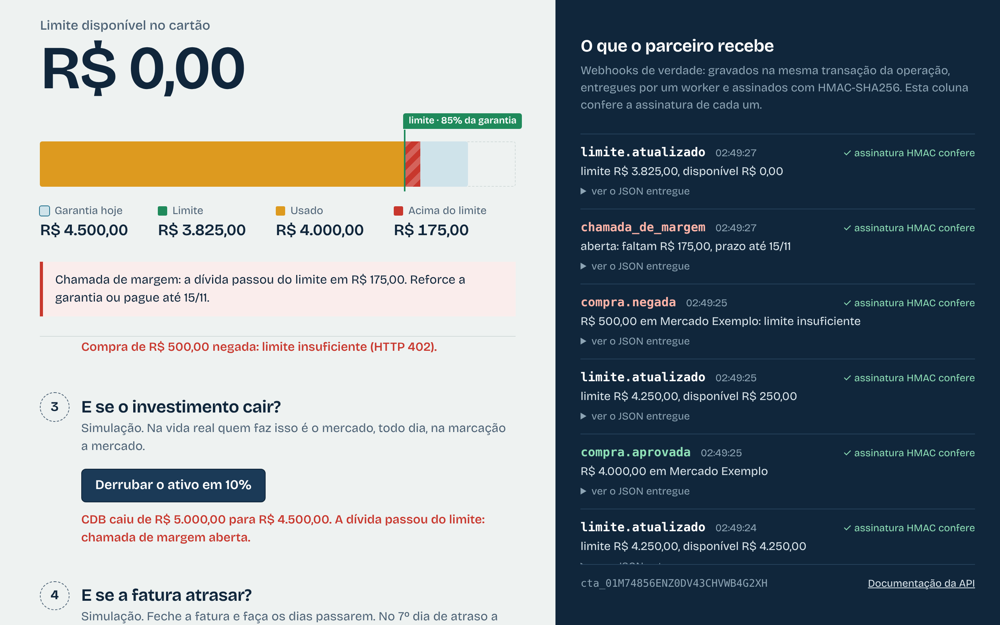
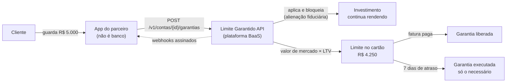
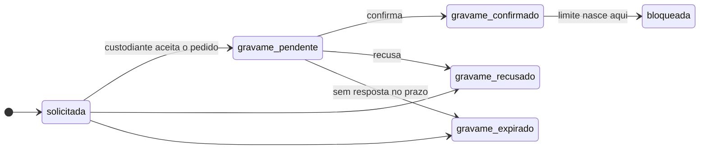
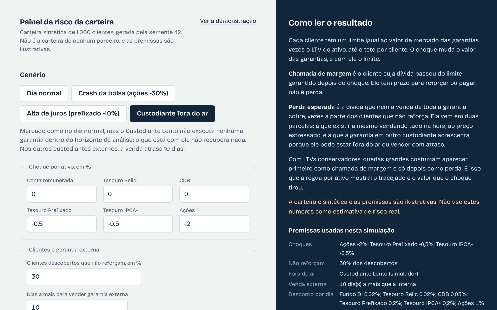

# Limite Garantido as a Service

Uma API para transformar o investimento do cliente em limite no cartão, pensada para
uma plataforma de Banking as a Service oferecer a parceiros que não são banco.

> **Projeto pessoal de estudo.** Foi feito só com informação pública, não é um produto
> real e não tem vínculo com nenhuma instituição. Não sou advogado: a modelagem jurídica
> precisa ser validada por quem é.



## O problema

Hoje o seu investimento só vira garantia de crédito na instituição onde ele está
guardado. Limite garantido já é um produto provado no varejo: vários bancos e fintechs
deixam você reservar um valor e usar como limite no cartão. Mas todos fazem isso com o
ativo da própria casa, para o cliente da própria casa.

Quem não é banco (uma fintech, um varejista, uma carteira digital) não consegue
oferecer o mesmo. O cliente dela resgata o investimento, paga juro alto ou fica sem
limite. Os casos e as fontes estão em [docs/mercado.md](docs/mercado.md).

## A ideia

A plataforma faz o trabalho difícil uma vez, para todos os parceiros. O parceiro só
chama a API.



1. O dinheiro do cliente vai para um investimento que continua rendendo.
2. O investimento é bloqueado como garantia.
3. O limite é `valor de mercado × LTV`, arredondado para baixo. O LTV depende do ativo:
   100% para dinheiro em conta, 85% para CDB, 60% para ações.
4. Se o ativo cai e a dívida passa do limite, abre uma chamada de margem com prazo.
5. Se a fatura é paga, a garantia pode ser resgatada. Se atrasa, no 7º dia ela é
   executada: vende-se só o valor da fatura e o resto continua sendo do cliente.

O caminho em três fases (dentro de casa, trilhos regulados, mercado aberto) e o desenho
do piloto estão em [docs/roadmap.md](docs/roadmap.md).

## Fase 2, simulada: investimento em outra instituição

Na fase 1 o investimento fica dentro de casa e o bloqueio é imediato. Na fase 2 ele
está em outra instituição: o bloqueio (gravame) é pedido a um custodiante externo, que
responde depois, e pode recusar ou não responder. **Aqui isso é uma simulação.** Não há
integração com nenhum custodiante real; os dois custodiantes, "Custodiante Ágil" e
"Custodiante Lento", são personagens fictícios com comportamento configurado em
[`app/custodiantes_simulados.toml`](app/custodiantes_simulados.toml).



- O limite só nasce depois de `gravame_confirmado`. Recusa e expiração não lançam nada
  no ledger e avisam o parceiro por webhook.
- No resgate, o limite sai já no pedido, não na confirmação. Na execução, a dívida só
  cai quando o custodiante confirma a venda, pelo valor que ela de fato rendeu.
- A resposta chega por callback assinado (HMAC-SHA256, com janela contra
  reapresentação) ou pela consulta de reserva que o worker faz. A mesma confirmação,
  venha por onde vier, é aplicada uma vez só.

| O que é real | O que é simulado |
|---|---|
| Máquina de estados, regras de limite, ledger e chamada de margem | Os custodiantes externos e as respostas deles |
| A rota de callback, a assinatura, a janela contra replay e a idempotência | O tempo de resposta, a chance de recusa e de silêncio (perfis fictícios) |
| A rotina que envia, consulta e expira pedidos, no worker | O preço obtido na venda da garantia externa |
| Os webhooks para o parceiro | Os botões "custodiante confirma / recusa / não responde" do `/demo` (sandbox) |
| O painel de risco e o cálculo de perda | A carteira de 1.000 clientes do `/risco` e as premissas dos cenários |

Onde entrariam os trilhos reais (TD Garantia para o Tesouro, o registro de garantias
de previdência) está em [docs/arquitetura.md](docs/arquitetura.md#onde-entraria-o-trilho-real),
com o que as fontes públicas dizem e o que ficou a confirmar.

## Painel de risco da carteira

Em `/risco`, uma carteira **sintética** de 1.000 clientes (mistura de depósito,
Tesouro, CDB e ações, parte com garantia em custodiante externo) passa por um choque.
Quatro cenários prontos: dia normal, crash da bolsa (ações −30%), alta de juros
(prefixado −10%) e custodiante fora do ar. A tela mostra clientes em chamada de margem,
limite antes e depois, a perda esperada separando o que vem da garantia externa e a
concentração por ativo e por custodiante. A carteira é gerada da mesma semente, e as
premissas são ilustrativas, não dado de mercado.



## Rodando em 3 comandos

**Com Docker** (Postgres, migrações, API e worker de webhooks):

```bash
git clone https://github.com/EnzoRenato16/limite-garantido-api.git
cd limite-garantido-api
docker compose up --build
```

Depois abra <http://localhost:8000/demo> (a demonstração),
<http://localhost:8000/risco> (o painel de risco) ou
<http://localhost:8000/docs> (a documentação da API).

**Sem Docker**, com [uv](https://docs.astral.sh/uv/):

```bash
uv sync                  # instala as dependências
uv run python demo.py    # a história inteira no terminal, sem configurar nada
./scripts/dev.sh         # sobe API e worker em SQLite; abra /demo e /risco
```

O `demo.py` roda a API de verdade dentro do processo e conta a história de um cliente:

```text
1. O cliente guarda R$ 5.000 em CDB
   LTV do CDB na política deste parceiro: 85%. Limite liberado: R$ 4.250,00
   garantia ████████████████████████████████████████████  R$ 5.000,00
   limite   █████████████████████████████████████░░░░░░░  R$ 4.250,00
   usado    ░░░░░░░░░░░░░░░░░░░░░░░░░░░░░░░░░░░░░░░░░░░░  R$ 0,00

4. O CDB cai 10% na marcação a mercado
   garantia ████████████████████████████████████████░░░░  R$ 4.500,00
   limite   ██████████████████████████████████░░░░░░░░░░  R$ 3.825,00
   usado    ███████████████████████████████████░░░░░░░░░  R$ 4.000,00
   disponível para comprar: R$ 0,00   dívida acima do limite: R$ 175,00

5. A fatura fecha e não é paga
   03/03  dia 1  fatura em atraso: novas compras suspensas
   08/03  dia 6  prazo da chamada de margem esgotado: conta bloqueada
   09/03  dia 7  7º dia de atraso: a garantia é executada
   Vendidos só os R$ 4.000,00 da fatura. Os R$ 500,00 que sobraram continuam bloqueados e rendendo.
```

## O que tem aqui

| Tema | O que foi feito |
|---|---|
| **Domínio** | Regras de crédito puras, sem banco e sem framework. Dinheiro em centavos inteiros, nunca `float`. Garantia com máquina de estados explícita. |
| **Ledger** | Partidas dobradas. Não existe campo de saldo: dívida e valor de garantia são somas do ledger. No Postgres, gatilhos tornam o ledger somente inserção e recusam lançamento que não fecha. |
| **Concorrência** | Trava de linha e versão otimista. Um teste dispara 40 compras simultâneas contra Postgres e exige que passem exatamente as que cabem. |
| **API** | Multi-tenant (API key por parceiro, só o hash no banco), idempotência persistida, erros RFC 7807 com códigos estáveis, paginação por cursor, rate limit, OpenAPI em português. |
| **Webhooks** | Outbox na mesma transação, worker com assinatura HMAC-SHA256 e timestamp, backoff exponencial, dead letter e reenvio manual. |
| **Risco** | Marcação a mercado com provedor de preços trocável, chamada de margem com prazo, tetos por cliente e por parceiro, simulador de stress e o painel `/risco` sobre carteira sintética. |
| **Custódia externa (simulada)** | Gravame assíncrono que pode ser recusado ou ficar sem resposta, callback assinado, consulta de reserva e prazo, idempotentes por evento do custodiante. |
| **Operação** | Logs JSON com `request_id` e `parceiro_id`, `/health`, `/metrics` para Prometheus. |
| **Demonstração** | `demo.py` no terminal, a página `/demo` (fases 1 e 2) e a `/risco`, testadas de ponta a ponta com Playwright. |

## Endpoints

A lista completa, com exemplos, está em `/docs` com a API no ar. Os principais:

| Método | Caminho | Para quê |
|---|---|---|
| `POST` | `/v1/contas` | Abrir a conta de um cliente do parceiro |
| `GET` | `/v1/contas/{id}` | Conta, posição de limite, fatura em aberto e chamada de margem |
| `POST` | `/v1/contas/{id}/garantias` | Bloquear um investimento como garantia ¹ |
| `POST` | `/v1/garantias/{id}/liberacao` | Devolver a garantia, se a dívida continuar coberta |
| `POST` | `/v1/contas/{id}/compras` | Autorizar uma compra (`402` se for negada) ¹ |
| `POST` | `/v1/contas/{id}/faturas` | Fechar a fatura |
| `POST` | `/v1/contas/{id}/pagamentos` | Registrar um pagamento ¹ |
| `GET` | `/v1/contas/{id}/lancamentos` | Extrato do ledger |
| `GET` | `/v1/eventos` | Tudo o que aconteceu, com filtros |
| `PUT` | `/v1/parceiro/webhook` | Configurar o webhook e receber o segredo de assinatura |
| `GET` | `/v1/webhooks/entregas` | Entregas, tentativas e dead letter |
| `POST` | `/v1/webhooks/entregas/{id}/reenvio` | Reenviar um webhook |
| `POST` | `/v1/risco/simulacoes-de-stress` | "E se ações caírem 30%?", na carteira real do parceiro |
| `POST` | `/v1/risco/simulacoes-de-carteira` | O painel de risco, sobre a carteira sintética |
| `GET` | `/v1/risco/cenarios` | Os quatro cenários prontos do painel |
| `GET` | `/v1/custodiantes` | Custodiantes externos aceitos (todos simulados) |
| `POST` | `/v1/custodiantes/{id}/callbacks` | Resposta do custodiante, autenticada por assinatura HMAC |
| `GET` | `/v1/erros` | Catálogo dos códigos de erro |
| `POST` | `/v1/sandbox/...` | Simular queda de preço, passagem de dias e a resposta do custodiante (só com o sandbox ligado) |
| `*` | `/v1/admin/...` | Parceiros, políticas, rotinas e conferência do ledger (uso da plataforma) |

¹ Exige o cabeçalho `Idempotency-Key`.

Um exemplo, com o parceiro de demonstração (a chave é fictícia e está no `.env.example`):

```bash
CHAVE=lgk_exemplo000000_chave-ficticia-so-para-a-demonstracao

curl -s localhost:8000/v1/contas -H "Authorization: Bearer $CHAVE" \
     -H "Content-Type: application/json" -d '{"cliente_ref": "cliente-1"}'

curl -s localhost:8000/v1/contas/<id>/garantias -H "Authorization: Bearer $CHAVE" \
     -H "Content-Type: application/json" -H "Idempotency-Key: $(uuidgen)" \
     -d '{"tipo_ativo": "cdb", "valor": "5000.00"}'
```

Para pedir o gravame em outra instituição, acrescente `"custodiante_id":
"custodiante_agil"` ao corpo: a resposta é `202` e a garantia nasce `solicitada`.

Eventos enviados por webhook: `garantia.bloqueada`, `garantia.liberada`,
`garantia.executada`, `limite.atualizado`, `compra.aprovada`, `compra.negada`,
`fatura.paga`, `fatura.em_atraso` (uma vez, na entrada em atraso) e `chamada_de_margem`.
Da fase 2: `gravame.solicitado`, `gravame.confirmado`, `gravame.recusado`,
`gravame.expirado`, `liberacao.solicitada`, `liberacao.confirmada`, `liberacao.falhou`,
`execucao.solicitada`, `execucao.confirmada` e `execucao.falhou`.

## Como o código está organizado

```text
app/
  dominio/     regras de crédito, ledger, política de risco, stress e painel (só biblioteca padrão)
  aplicacao/   casos de uso e as interfaces de que eles precisam
  infra/       SQLAlchemy, worker de webhooks, simulador de custodiantes, carteira sintética
  api/         rotas FastAPI, erros, idempotência, paginação e as páginas /demo e /risco
alembic/       migrações (inclui os gatilhos do ledger)
tests/
  unidade/       domínio e peças de infraestrutura
  propriedade/   Hypothesis: invariantes que valem para qualquer sequência de operações
  integracao/    API contra SQLite e contra Postgres
  e2e/           as páginas /demo e /risco num navegador, com Playwright
docs/          arquitetura, mercado, roadmap, riscos, decisões
```

Os diagramas de sequência e de estados estão em [docs/arquitetura.md](docs/arquitetura.md).

## Testes e qualidade

```bash
uv run pytest                    # unidade, propriedade e integração em SQLite
uv run pytest -m e2e             # as páginas /demo e /risco num navegador

scripts/pg_local.sh subir        # ou qualquer Postgres 16
DATABASE_URL_TESTE=postgresql+psycopg://lg:lg@localhost:54329/lg_teste uv run pytest

uv run ruff check . && uv run ruff format --check . && uv run mypy app
```

- A suíte roda sem Docker, em SQLite. Com `DATABASE_URL_TESTE` apontando para um
  Postgres, a mesma suíte roda nele e entram os testes que precisam de trava de linha e
  dos gatilhos do ledger.
- Cobertura do domínio: 99% (o mínimo exigido no CI é 90%).
- Testes de propriedade com Hypothesis sorteiam sequências de operações e conferem,
  depois de cada passo, que o limite nunca fica negativo, que o ledger fecha em zero e
  que a execução nunca vende mais do que a fatura vencida. Na fase 2, uma máquina
  sorteia respostas do custodiante (válidas, repetidas ou fora de hora) e confere que
  nenhum limite nasce antes da confirmação do gravame.
- No painel: a perda nunca é negativa nem passa da exposição, choque mais forte nunca
  diminui a perda, e custodiante fora do ar só mexe na parcela externa.
- mypy no projeto inteiro, em modo estrito no domínio. Ruff com as regras de segurança.
- O CI (GitHub Actions) roda lint, tipos, auditoria de dependências, os testes em
  SQLite e Postgres, o teste de navegador e um job que sobe o `docker compose` e faz um
  teste de fumaça até o webhook ser entregue.

## Decisões que valem a leitura

Todas estão em [docs/DECISOES.md](docs/DECISOES.md). As que mais mudam o desenho:

- **Saldo nunca é coluna.** Tudo é soma do ledger, e o banco ajuda a garantir isso.
- **A execução cobre só a fatura vencida** e vende o mínimo. O que sobra continua
  bloqueado, rendendo, e é do cliente.
- **Compra negada é resultado, não erro.** Fica registrada, gera evento e é idempotente.
- **O teto do parceiro é sobre a carteira** (o que está de fato emprestado), conferido a
  cada compra com a linha do parceiro travada.
- **O que os testes pegaram.** Um deadlock e um esgotamento de pool que só apareceram
  com 40 requisições simultâneas contra Postgres. Está contado no fim do documento.
- **Na fase 2, o pedido ao custodiante sai depois do commit**, pelo worker, para nunca
  existir gravame lá sem registro aqui. E cada resposta tem chave única
  `(custodiante, evento)` no banco: dez callbacks iguais ao mesmo tempo aplicam uma vez.

## Próximos passos

O que um especialista criticaria, e que não está resolvido aqui.

**Crédito**

- Juros, multa e IOF do atraso não existem. A dívida executada no 7º dia é o principal,
  então a perda real seria maior que a calculada.
- A execução vende ao preço de marcação. Falta um desconto de liquidação por ativo.
- Não há estorno nem contestação de compra, nem separação entre autorização e captura.
- O ciclo de fatura é mínimo: uma fatura em aberto por conta, sem pagamento mínimo, sem
  rotativo e sem parcelamento.
- Não há limite de concentração por ativo ou por emissor.
- A chamada de margem bloqueia a conta, mas não liquida. Se deve liquidar é decisão
  jurídica e de risco.
- Liberação é tudo ou nada. Falta resgate parcial.
- Uma confirmação de gravame que chega depois de o pedido expirar fica registrada como
  obsoleta, mas não há rotina de reconciliação para desfazer o gravame do lado do
  custodiante.
- Liberação ou execução externa que falha volta a garantia para `bloqueada`, mesmo se
  ela estava `parcialmente_executada` (perde-se o rótulo, não o valor).

**Produto e integração**

- A custódia, o preço e o cartão são simulados. Falta integrar com o produto de
  investimento, com um provedor de preços real e com a processadora.
- A fase 2 inteira é simulada: falta um adaptador real da porta `Custodiante` (TD
  Garantia, registro de previdência), e o simulador não guarda estado (responde a
  qualquer id de pedido bem formado).
- O painel de risco roda sobre uma carteira sintética. Rodar o mesmo cálculo na
  carteira real do parceiro, como job, é o passo seguinte.
- A cessão dos recebíveis ao FIDC e a liquidação com a rede não estão no ledger.
- Consentimento do cliente (Open Finance) não está modelado.
- A política de risco não tem versão, histórico nem aprovação em duas etapas.

**Engenharia**

- O saldo é somado do ledger a cada operação. Com volume, precisa de saldo consolidado
  por período, conferido contra o ledger.
- A listagem de contas calcula a posição conta a conta. O simulador de stress carrega a
  carteira inteira do parceiro em memória; deveria ser um job.
- O rate limit é por instância e vale só depois da autenticação.
- As rotinas de risco rodam por linha de comando ou pela API administrativa. Falta
  agendamento, alerta de "não rodou hoje" e calendário de dias úteis.
- Não há rastreamento distribuído (OpenTelemetry) nem métricas do worker expostas.

**Segurança**

- O segredo do webhook fica em texto no banco. Deveria ser cifrado com chave externa.
- A API administrativa tem um token único: sem usuários, papéis nem trilha de auditoria.
- API keys não expiram, não têm escopo e não têm restrição de origem.
- A validação anti-SSRF do webhook não fecha a janela entre resolver o DNS e conectar.
- A assinatura HMAC tem o mesmo formato nos webhooks de saída e nos callbacks de
  custodiante; falta separar o contexto (prefixo no que é assinado).
- `AMBIENTE` tem padrão `desenvolvimento`: um deploy que esqueça a variável liga o
  simulador de custodiantes. Deveria ser obrigatória.
- A rota de callback dos custodiantes não tem rate limit próprio.
- As imagens Docker estão fixadas por tag, não por digest.

Os riscos de produto, crédito, jurídico, operacional e tecnológico, com a resposta de
cada um, estão em [docs/riscos.md](docs/riscos.md).

## Documentação

| Documento | O que tem |
|---|---|
| [docs/arquitetura.md](docs/arquitetura.md) | Camadas, ledger, estados e os diagramas de sequência |
| [docs/mercado.md](docs/mercado.md) | Quem já faz, base legal e o que foi (ou não) confirmado em fonte |
| [docs/roadmap.md](docs/roadmap.md) | As três fases, o piloto e as métricas |
| [docs/riscos.md](docs/riscos.md) | Riscos e respostas |
| [docs/DECISOES.md](docs/DECISOES.md) | As decisões tomadas e o que os testes pegaram |
| [docs/plano.md](docs/plano.md) | O plano de implementação da v1.0 |
| [docs/plano-fase2.md](docs/plano-fase2.md) | O plano da fase 2 simulada e do painel de risco |
| [docs/roteiro-video.md](docs/roteiro-video.md) | Roteiro de 2 min 30 s: fase 1, fase 2 e o painel |

## Sobre

Feito por Enzo Renato, engenheiro de dados e estudante de Engenharia da Computação,
como projeto de portfólio. Foi construído com o apoio do Claude Code a partir de um
briefing meu; as decisões tomadas pelo caminho estão registradas em
[docs/DECISOES.md](docs/DECISOES.md).

A fonte usada na página de demonstração é a Bricolage Grotesque, sob licença SIL OFL
(o texto da licença está em `app/api/estatico/fontes/OFL.txt`).
