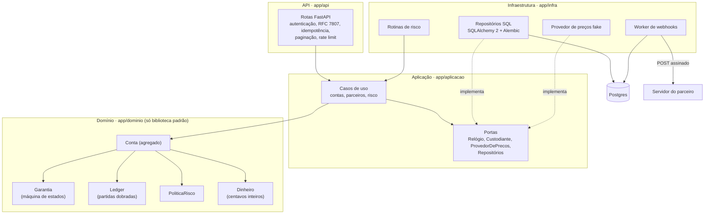
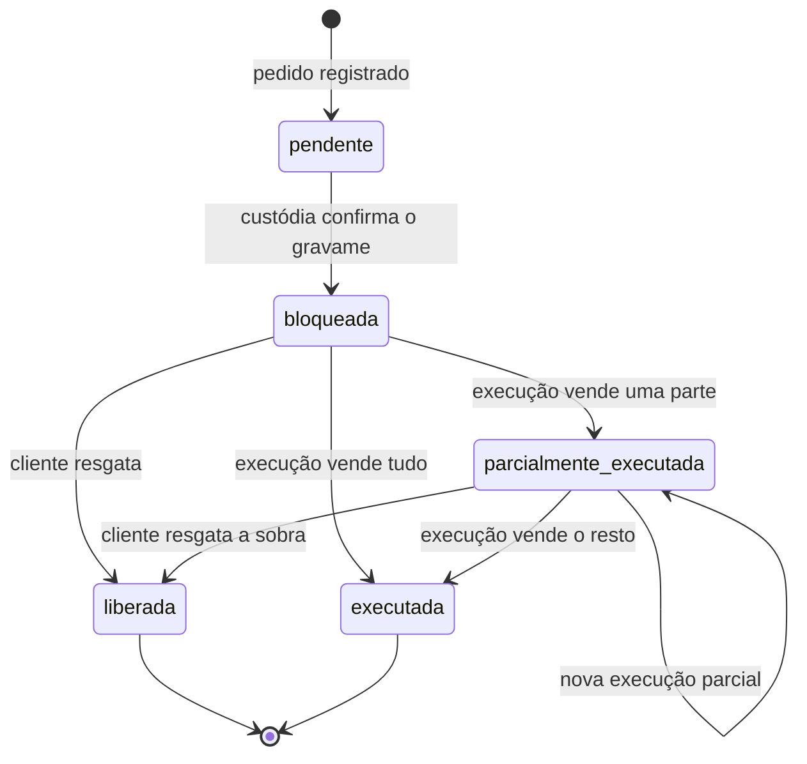
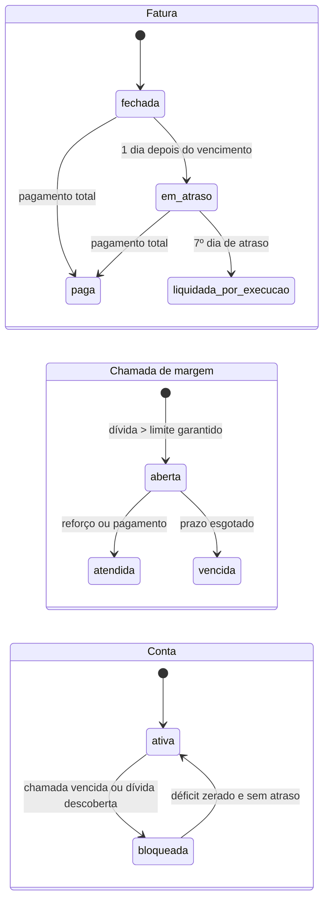
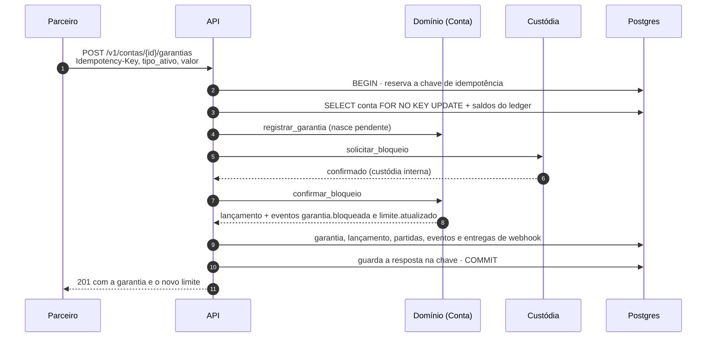
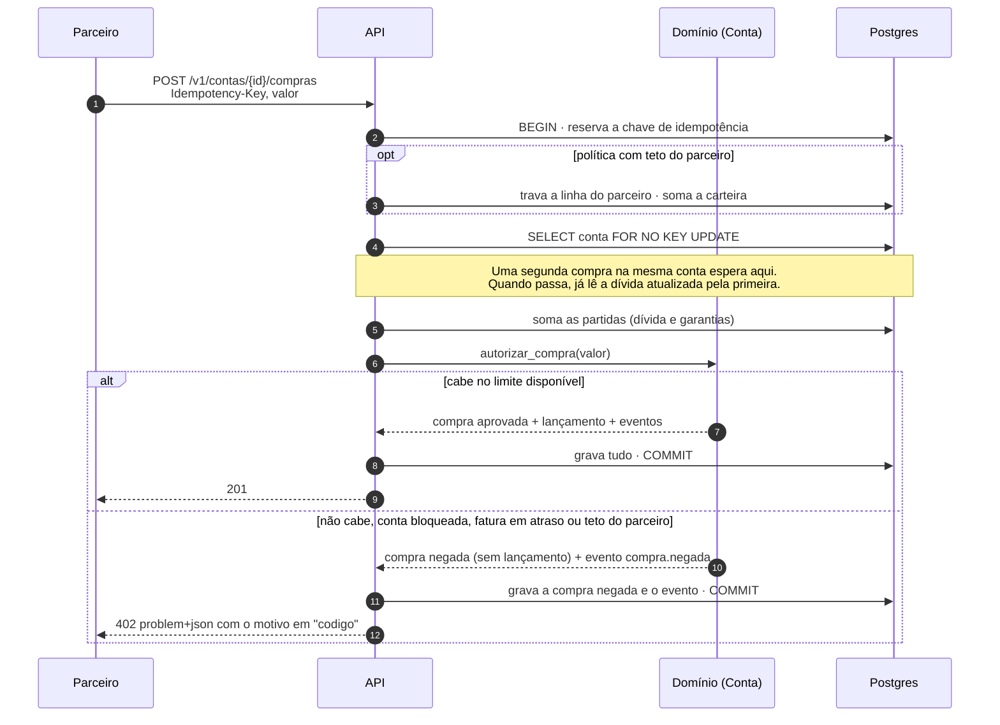
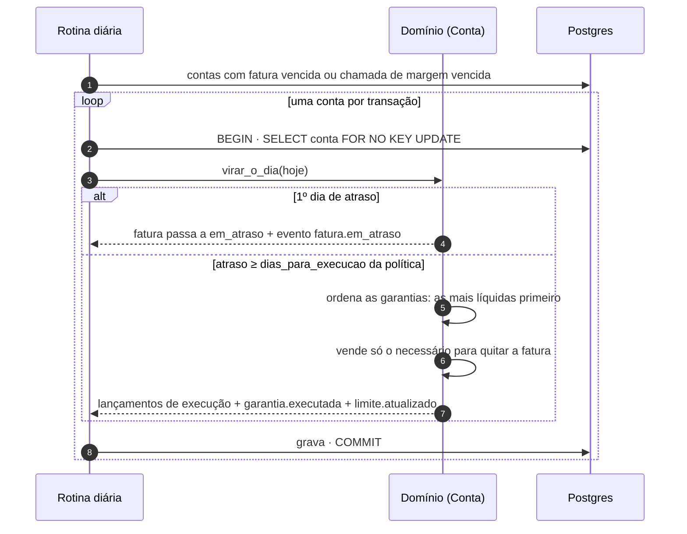
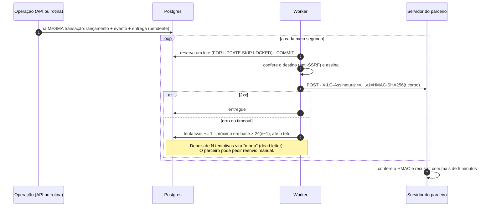

# Arquitetura

Este documento mostra como o código está organizado e o que acontece, passo a passo, nas
quatro operações que mais importam: bloquear uma garantia, autorizar uma compra, executar
a garantia e entregar um webhook.

## Camadas

A regra de dependência é uma só: as setas apontam para dentro. O domínio não importa
FastAPI, SQLAlchemy nem relógio; `agora` e `hoje` chegam como argumento. Isso tem um
efeito prático: as regras de crédito são testadas em milissegundos, sem banco, e a
máquina de estados do Hypothesis consegue sortear milhares de sequências de operações.

| Camada | O que mora ali | O que não pode fazer |
|---|---|---|
| `app/dominio` | `Conta`, `Garantia`, `Lancamento`, `PoliticaRisco`, `Dinheiro`, simulador de stress | Importar qualquer coisa fora da biblioteca padrão |
| `app/aplicacao` | Casos de uso e as portas (interfaces) de que eles precisam | Falar SQL ou HTTP |
| `app/infra` | SQLAlchemy, Alembic, worker, rotinas, logs, métricas, provedor de preços | Decidir regra de crédito |
| `app/api` | Rotas, esquemas, erros, idempotência, página `/demo` | Ter regra de negócio |

## O dinheiro: ledger de partidas dobradas

Não existe coluna de saldo no banco. Dívida e valor de garantia são sempre a soma das
partidas do ledger. Toda movimentação vira um lançamento em que débitos e créditos
somam o mesmo valor.

| Conta contábil | Natureza | O que representa |
|---|---|---|
| `garantias_custodiadas` | devedora | Valor de mercado dos investimentos bloqueados |
| `garantias_a_devolver` | credora | Contrapartida: a garantia é do cliente e volta para ele |
| `recebiveis_a_faturar` | devedora | Compras aprovadas que ainda não entraram em fatura |
| `recebiveis_faturados` | devedora | Fatura fechada e ainda não paga |
| `liquidacao_a_pagar` | credora | O que a plataforma deve à rede pelas compras aprovadas |
| `caixa_recebimentos` | devedora | O que entrou: pagamentos e execução de garantia |

As duas primeiras são contas de compensação: registram a garantia recebida sem misturar
com o dinheiro da operação de crédito.

| Operação | Débito | Crédito |
|---|---|---|
| Bloqueio de garantia | `garantias_custodiadas` | `garantias_a_devolver` |
| Marcação a mercado (queda) | `garantias_a_devolver` | `garantias_custodiadas` |
| Compra aprovada | `recebiveis_a_faturar` | `liquidacao_a_pagar` |
| Fechamento de fatura | `recebiveis_faturados` | `recebiveis_a_faturar` |
| Pagamento | `caixa_recebimentos` | `recebiveis_faturados` (e o que sobrar em `recebiveis_a_faturar`) |
| Execução | `garantias_a_devolver` e `caixa_recebimentos` | `garantias_custodiadas` e `recebiveis_faturados` |
| Liberação | `garantias_a_devolver` | `garantias_custodiadas` |

A partir daí, tudo é leitura:

- **dívida** = saldo de `recebiveis_a_faturar` + `recebiveis_faturados`;
- **valor de uma garantia** = saldo de `garantias_custodiadas` daquela garantia;
- **limite** = soma de `valor de mercado × LTV` de cada garantia ativa, cada parcela
  arredondada para baixo, limitada pelo teto por cliente;
- **limite disponível** = `max(0, limite − dívida)`, e zero se a conta estiver bloqueada.

O ledger é protegido em três lugares. No domínio, um `Lancamento` desbalanceado não
chega a existir (o construtor recusa). No Postgres, um gatilho confere no commit que
cada lançamento fecha, e outro impede `UPDATE` e `DELETE` nas tabelas do ledger. E um
teste de propriedade sorteia sequências de operações e confere que a soma é sempre zero.

## Estados

### Garantia

Só `bloqueada` e `parcialmente_executada` contam para o limite. Qualquer transição fora
do desenho responde `409 transicao_de_estado_invalida`, com o estado atual e o pedido.

`pendente` existe por causa das fases 2 e 3 do [roadmap](roadmap.md): quando o
investimento está fora de casa, o gravame é confirmado por um terceiro e pode demorar.
Dentro de casa a confirmação é imediata e a garantia já nasce `bloqueada` na resposta.

### Fatura, chamada de margem e conta

## Sequências

### 1. Bloquear uma garantia

### 2. Autorizar uma compra

Compra negada não é exceção: é um resultado de negócio, gravado e idempotente como a
compra aprovada. Repetir a mesma `Idempotency-Key` devolve a mesma decisão.

### 3. Executar a garantia no 7º dia

Três escolhas estão embutidas aqui. A execução cobre só a fatura vencida, não as compras
que ainda nem venceram. Vende-se o mínimo: o que sobra da garantia continua bloqueado e
rendendo. E cada conta tem a sua transação, de modo que uma conta com problema não
impede as outras.

### 4. Entregar um webhook

O que o padrão outbox garante: não existe operação confirmada sem evento, nem evento de
operação desfeita. O que ele não garante: entrega exatamente uma vez. A entrega é "pelo
menos uma vez", e por isso todo evento tem um `id` estável para o receptor reconhecer
repetição. A requisição HTTP acontece fora de qualquer transação: o worker reserva,
envia e só então grava o resultado, sem segurar conexão do banco durante a chamada.

## Concorrência

O risco clássico de um autorizador é duas compras lerem o mesmo limite e as duas
passarem. Aqui há duas defesas, e a segunda existe para o caso de a primeira ser
esquecida numa alteração futura.

1. **Trava de linha.** Toda escrita carrega a conta com `SELECT ... FOR NO KEY UPDATE`.
   A segunda transação espera a primeira terminar e só então soma o ledger.
2. **Versão otimista.** A conta tem uma coluna `versao`. A gravação é um
   `UPDATE ... WHERE versao = <a que eu li>`; se não afetar nenhuma linha, a operação é
   desfeita e responde `409 conflito_de_concorrencia`.

O teste de concorrência dispara 40 compras de R$ 100 ao mesmo tempo num limite de
R$ 1.000, contra Postgres de verdade, e exige exatamente 10 aprovadas. Foi ele que
encontrou os dois problemas descritos em [DECISOES.md](DECISOES.md): um deadlock por
*upgrade* de lock e um esgotamento do pool de conexões.

Ordem das travas, sempre a mesma para não haver deadlock: parceiro (só quando a política
tem teto de carteira) e depois conta.

## Multi-tenant

Cada parceiro tem a sua API key. No banco ficam o prefixo (para achar a linha) e o
SHA-256 da chave; a chave inteira aparece uma vez, na criação. Toda consulta filtra por
`parceiro_id`, e pedir um recurso de outro parceiro responde `404`, nunca `403`: para
quem pergunta, ele simplesmente não existe.

A política de risco é do parceiro (LTV por ativo, ordem de execução, prazos, tetos) e
quem a altera é a plataforma, pela API administrativa.

## Observabilidade

- **Logs** em JSON, uma linha por evento, sempre com `request_id` e `parceiro_id`.
- **`X-Request-Id`** em toda resposta, inclusive nos erros 500. O mesmo id está no log e
  no corpo do erro.
- **`/metrics`** no formato do Prometheus: requisições por rota e status (com o template
  da rota, não o caminho real), tempo de resposta, eventos de negócio por tipo e tamanho
  da fila de webhooks.
- **`/health`** responde 200 quando a API fala com o banco e 503 quando não.
