# Arquitetura

Este documento mostra os papéis, como o código está organizado e o que acontece, passo a
passo, nas operações que mais importam: registrar o gravame, autorizar uma compra,
executar a garantia, entregar um webhook e trazer um ativo de fora.

> O projeto **simula** o registro na B3 e no Selic, a plataforma da Res. Conjunta 12 e
> as contrapartes. Nenhuma integração real existe.

## Papéis

| Papel | O que faz | Observação |
|---|---|---|
| Entidade tomadora de BaaS | A fintech parceira: só interface e distribuição | Não concede o crédito nem emite o cartão (Res. Conjunta 16/2025, art. 6º, I) |
| Plataforma BaaS (esta API) | Presta o serviço de garantia ao parceiro | Responde pelos serviços que presta (Res. Conjunta 16/2025, arts. 9º, 10 e 16) |
| SCD do grupo | Concede o crédito, emite o cartão e é a beneficiária do gravame | Papel genérico; não nomeia empresa |
| CTVM do grupo | Custodia o ativo e comanda o gravame | O custodiante comanda; a registradora registra |
| DTVM do grupo | Administra os fundos DI | |
| Registradora ou depositário central | Registra o gravame (B3 ou Selic) | Lei 12.810/2013, art. 26. **Simulado aqui** |
| Agente de custódia | Custodia o Tesouro Direto do cliente (TD Garantia) | Simulado |
| Entidade operadora | Seguradora, EAPC ou sociedade de capitalização da previdência | Simulada; troca informações pela plataforma autorizada da Res. Conjunta 12 |

## Os trilhos

Cada tipo de ativo chega à garantia por um caminho. A regra de qual caminho serve a qual
ativo e produto mora no catálogo (`app/regulacao.toml`), e o domínio só pergunta a ele.

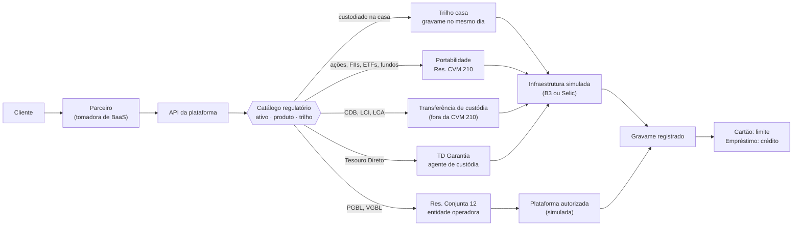

## Camadas

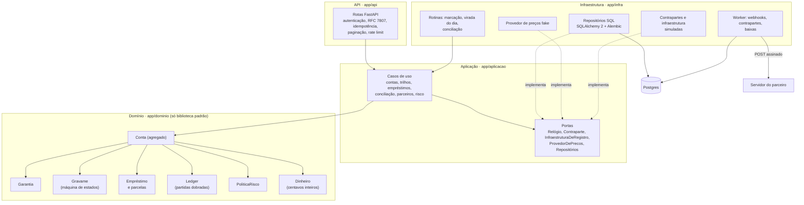

A regra de dependência é uma só: as setas apontam para dentro. O domínio não importa
FastAPI, SQLAlchemy nem relógio; `agora` e `hoje` chegam como argumento. Isso tem um
efeito prático: as regras de crédito são testadas em milissegundos, sem banco, e a
máquina de estados do Hypothesis consegue sortear milhares de sequências de operações.

| Camada | O que mora ali | O que não pode fazer |
|---|---|---|
| `app/dominio` | `Conta`, `Garantia`, `Gravame`, `Emprestimo`, `Lancamento`, `PoliticaRisco`, `Dinheiro`, o catálogo regulatório, simulador de stress, modelo econômico (`economia/`, ver [economia.md](economia.md)) | Importar qualquer coisa fora da biblioteca padrão |
| `app/aplicacao` | Casos de uso e as portas (interfaces) de que eles precisam | Falar SQL ou HTTP |
| `app/infra` | SQLAlchemy, Alembic, worker, rotinas, logs, métricas, provedor de preços, contrapartes e infraestrutura simuladas | Decidir regra de crédito |
| `app/api` | Rotas, esquemas, erros, idempotência, páginas `/demo`, `/regulacao`, `/risco` e `/negocio` | Ter regra de negócio |

## O dinheiro: ledger de partidas dobradas

Não existe coluna de saldo no banco. Dívida e valor de garantia são sempre a soma das
partidas do ledger. Toda movimentação vira um lançamento em que débitos e créditos
somam o mesmo valor.

| Conta contábil | Natureza | O que representa |
|---|---|---|
| `garantias_custodiadas` | devedora | Valor de mercado dos ativos com gravame registrado |
| `cupons_vinculados` | devedora | Cupom e amortização de Tesouro com gravame, vinculados à garantia |
| `excedente_a_devolver` | credora | Sobra da execução que volta ao cliente |
| `emprestimos_a_receber` | devedora | Saldo do empréstimo com garantia |
| `desembolsos_a_liquidar` | credora | Desembolso do empréstimo ainda não pago ao cliente |
| `receita_de_juros` | credora | Juros do empréstimo recebidos |
| `garantias_a_devolver` | credora | Contrapartida: a garantia é do cliente e volta para ele |
| `recebiveis_a_faturar` | devedora | Compras aprovadas que ainda não entraram em fatura |
| `recebiveis_faturados` | devedora | Fatura fechada e ainda não paga |
| `liquidacao_a_pagar` | credora | O que a plataforma deve à rede pelas compras aprovadas |
| `caixa_recebimentos` | devedora | O que entrou: pagamentos e execução de garantia |

As duas primeiras (e `cupons_vinculados`) são contas de compensação: registram a garantia
recebida sem misturar com o dinheiro da operação de crédito.

| Operação | Débito | Crédito |
|---|---|---|
| Gravame registrado | `garantias_custodiadas` | `garantias_a_devolver` |
| Marcação a mercado (queda) | `garantias_a_devolver` | `garantias_custodiadas` |
| Compra aprovada | `recebiveis_a_faturar` | `liquidacao_a_pagar` |
| Fechamento de fatura | `recebiveis_faturados` | `recebiveis_a_faturar` |
| Pagamento | `caixa_recebimentos` | `recebiveis_faturados` (e o que sobrar em `recebiveis_a_faturar`) |
| Execução (por inteiro) | `garantias_a_devolver` e `caixa_recebimentos` | `garantias_custodiadas`, `recebiveis_faturados` e `excedente_a_devolver` (a sobra) |
| Devolução do excedente | `excedente_a_devolver` | `caixa_recebimentos` |
| Baixa pedida (liberação) | `garantias_a_devolver` | `garantias_custodiadas` |
| Empréstimo contratado | `emprestimos_a_receber` | `desembolsos_a_liquidar` |

A partir daí, tudo é leitura:

- **dívida** = saldo de `recebiveis_a_faturar` + `recebiveis_faturados`;
- **valor de uma garantia** = saldo de `garantias_custodiadas` (mais `cupons_vinculados`) daquela garantia;
- **limite** = soma de `valor de mercado × LTV` de cada garantia ativa, cada parcela
  arredondada para baixo, limitada pelo teto por cliente;
- **limite disponível** = `max(0, limite − dívida)`, e zero se a conta estiver bloqueada.

O ledger é protegido em três lugares. No domínio, um `Lancamento` desbalanceado não
chega a existir (o construtor recusa). No Postgres, um gatilho confere no commit que
cada lançamento fecha, e outro impede `UPDATE` e `DELETE` nas tabelas do ledger. E um
teste de propriedade sorteia sequências de operações e confere que a soma é sempre zero.

## Estados

### Gravame

O gravame é o registro na infraestrutura (a registradora ou o depositário central) e tem
a sua própria máquina de estados. A garantia é a relação de crédito: produto, valor, LTV,
instrumento e a dívida que cobre. O limite do cartão e o valor do empréstimo só existem
com o gravame `registrado` e sem baixa pedida (decisão 75).

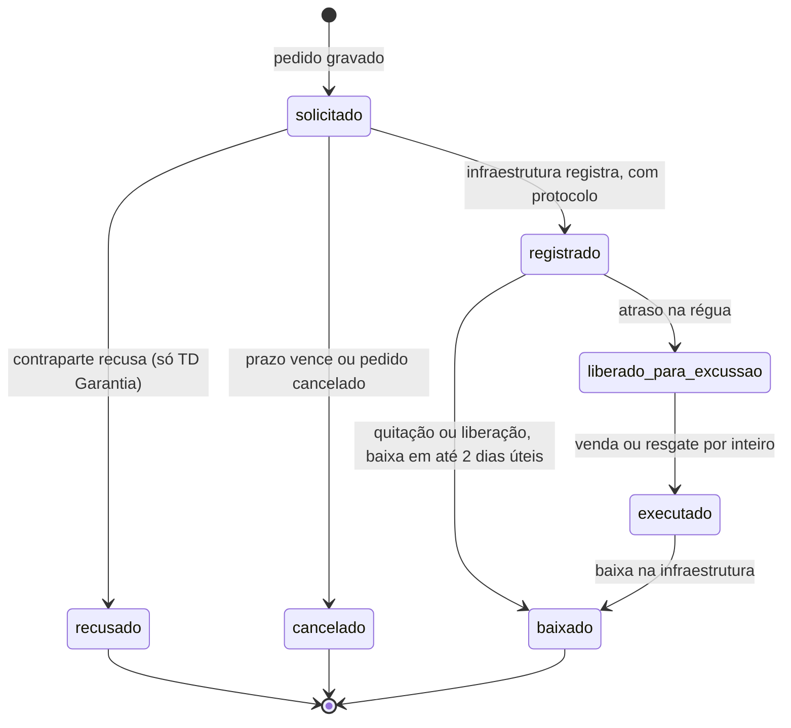

| Estado | Gera limite | Cobre a dívida | Espera a infraestrutura ou a contraparte |
|---|---|---|---|
| `solicitado` | não | não | sim |
| `registrado` (sem baixa pedida) | sim | sim | não |
| `registrado` (com baixa pedida) | não, desde o pedido | não | sim, até a baixa |
| `liberado_para_excussao`, `executado` | não | sim, até a venda | sim |
| `recusado`, `cancelado`, `baixado` | não | não | não |

Recusa e cancelamento nunca geram lançamento. Uma garantia na casa nasce `solicitado` e
`registrado` na mesma requisição, porque o registro é do mesmo grupo; nos trilhos de fora,
fica `solicitado` até a contraparte responder. Qualquer transição fora do desenho responde
`409 transicao_de_estado_invalida`, com o estado atual e o pedido.

A baixa é pedida na hora, com prazo de 2 dias úteis (decisão 77), e uma rotina
de conciliação aponta gravame sem dívida, dívida sem gravame e baixa atrasada.

### Empréstimo com garantia

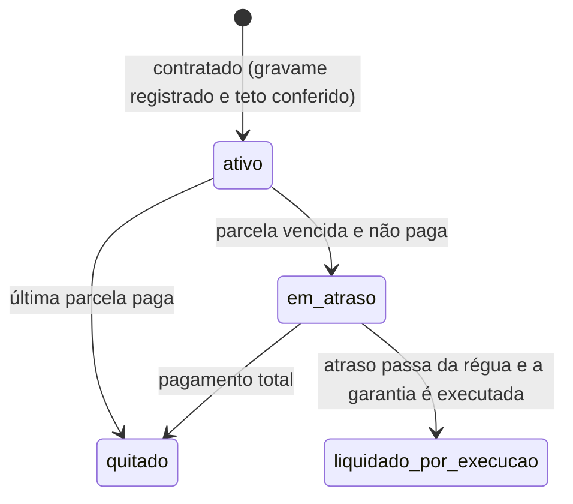

A régua de atraso vem da política (30 dias na maior parte dos ativos). Na previdência, a
execução só vem depois de 90 dias de atraso (Res. Conjunta 12, art. 12), com avisos aos 45
dias e 10 dias antes da execução. Os juros do saldo devedor correm pro rata, arredondados
para cima.

### Fatura, chamada de margem e conta

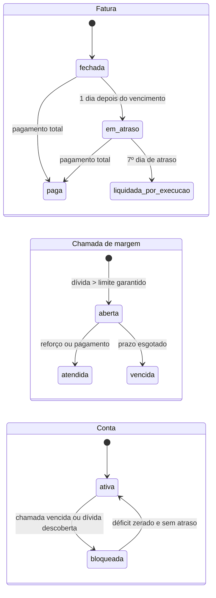

## Sequências

### 1. Registrar o gravame na casa

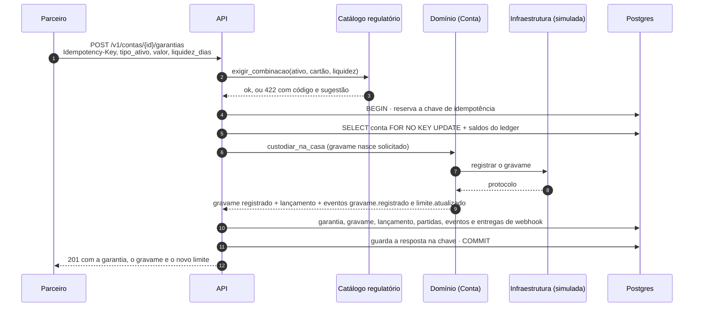

### 2. Autorizar uma compra

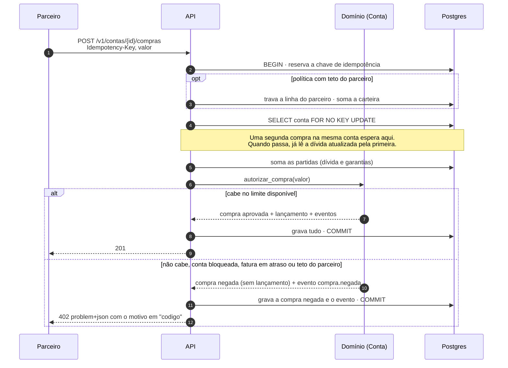

Compra negada não é exceção: é um resultado de negócio, gravado e idempotente como a
compra aprovada. Repetir a mesma `Idempotency-Key` devolve a mesma decisão.

### 3. Executar a garantia no 7º dia

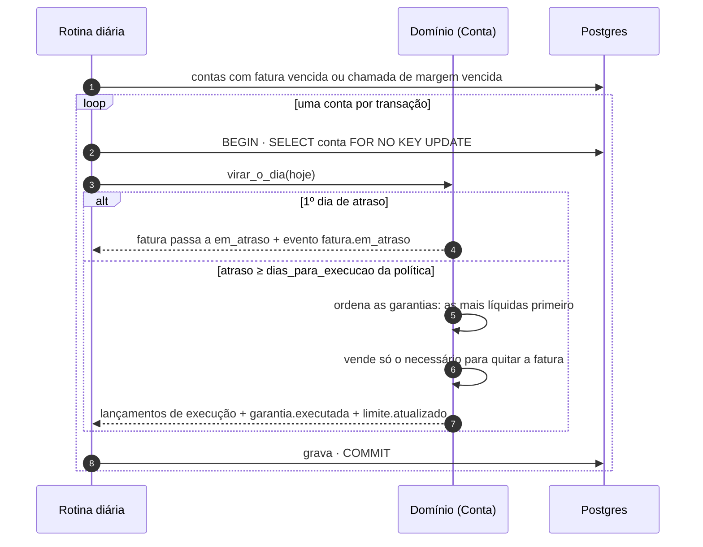

Três escolhas estão embutidas aqui. A execução cobre só a fatura vencida, não as compras
que ainda nem venceram. Vende-se o mínimo: o que sobra da garantia continua bloqueado e
rendendo. E cada conta tem a sua transação, de modo que uma conta com problema não
impede as outras.

### 4. Entregar um webhook

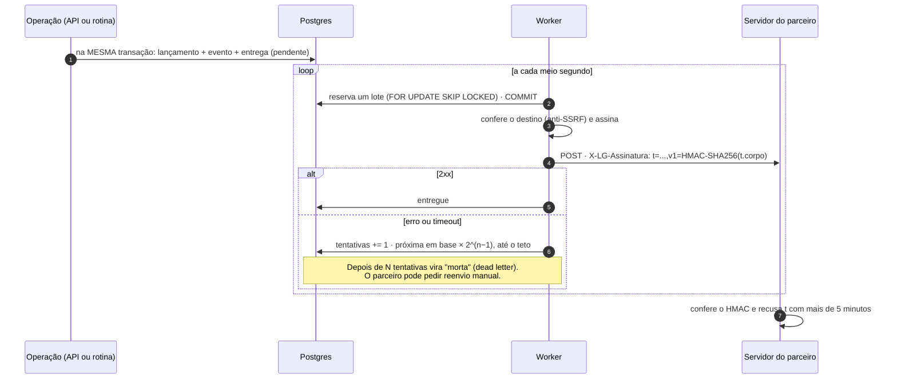

O que o padrão outbox garante: não existe operação confirmada sem evento, nem evento de
operação desfeita. O que ele não garante: entrega exatamente uma vez. A entrega é "pelo
menos uma vez", e por isso todo evento tem um `id` estável para o receptor reconhecer
repetição. A requisição HTTP acontece fora de qualquer transação: o worker reserva,
envia e só então grava o resultado, sem segurar conexão do banco durante a chamada.

### 5. Trazer um ativo de fora: portabilidade, caminho feliz

```mermaid
sequenceDiagram
    autonumber
    participant P as Parceiro
    participant A as API
    participant D as Domínio
    participant B as Banco
    participant W as Worker (rotina de contrapartes)
    participant C as Contraparte (simulada)
    P->>A: POST /v1/contas/{id}/portabilidades {contraparte_id, ativo, valor}
    A->>D: pedir entrada (gravame solicitado, com prazo em dias úteis)
    A->>B: garantia + gravame + pedido + evento portabilidade.solicitada
    A-->>P: 202, limite ainda zero
    Note over W,C: O pedido sai depois do commit: nunca há registro lá sem registro aqui
    W->>C: solicitar a entrada
    alt o callback chega
        C->>A: POST /v1/contrapartes/{id}/callbacks (assinado)
        A->>A: confere HMAC e janela do timestamp
    else o callback não chega
        W->>C: consultar
        C-->>W: concluída, evento_id
    end
    A->>B: trava a conta; (contraparte, evento_id) já existe?
    alt primeira vez
        A->>D: concluir a entrada e registrar o gravame na infraestrutura
        A->>B: lançamento + resposta registrada + eventos
        B-->>P: webhooks portabilidade.concluida, gravame.registrado, limite.atualizado
    else mesma resposta de novo
        A-->>C: 200 {"resultado": "duplicada"}, nada muda
    end
```

### 6. Entrada recusada ou com impedimento

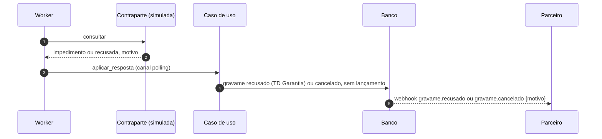

Na portabilidade da CVM 210, só `impedimento` é aceito como resposta negativa e as demais
são recusa (art. 19); resposta de um trilho no outro dá `422`.

### 7. Contraparte sem resposta no prazo

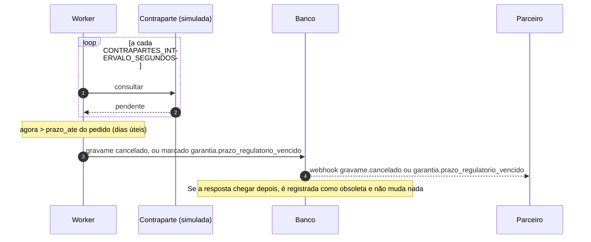

### 8. Baixa e conciliação

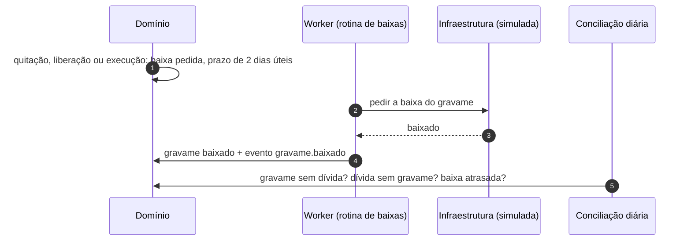

## Onde entraria o trilho real

A integração real pararia em duas portas (`app/aplicacao/portas.py`): `Contraparte`
(a outra ponta do pedido de entrada: corretora, banco de origem, agente de custódia,
entidade operadora) e `InfraestruturaDeRegistro` (a B3 ou o Selic). Os simuladores
(`app/infra/contrapartes.py` e `app/infra/infraestrutura_simulada.py`) são uma
implementação delas; uma real seria outra, com os mesmos métodos.

| Ativo | Trilho que existe | O que as fontes públicas dizem | O que não sabemos |
|---|---|---|---|
| Tesouro Direto | TD Garantia | Anunciado em 25/11/2024 por B3, Tesouro Nacional e Banco Central; permite ao investidor pessoa física usar títulos do Tesouro Direto como garantia (prática de mercado). O Selic passou a registrar gravames desses títulos (fonte secundária). | Quem pode receber a garantia e como a instituição se habilita, o protocolo, se há callback ou só consulta, os prazos. |
| Previdência, seguro de pessoas, capitalização | Lei 14.652/2023 e Resolução Conjunta CNSP/CMN nº 12/2024 | O direito de resgate pode ser dado em garantia de operações de crédito; a operadora informa em 2 dias úteis e não recusa pedido que siga a norma (arts. 4º, §1º, e 18); a execução só vem após 90 dias de atraso (art. 12). | O RC Garantias da B3, anunciado em 11/11/2025 para o início de 2026, e se já opera: não verificado. |
| Ações, FIIs, ETFs, cotas de fundos | Portabilidade da Res. CVM 210/2024 | Prazo de 2, 5 ou até 9 dias úteis (art. 16). | Como o custodiante de origem trata o gravame durante a portabilidade. |
| CDB, LCI, LCA | Transferência de custódia, fora da CVM 210 | Entendimento corrente: ficam fora da CVM 210 (Lei 6.385, art. 2º, §1º), interpretação. | Não encontramos norma que obrigue o custodiante de origem a registrar gravame para credor de outra instituição, nem prazo regulatório. |

As fontes, e o que foi confirmado em fonte oficial ou só em fonte secundária, estão em
[mercado.md](mercado.md#trilhos-regulados-que-já-existem) e, por ativo, em
[regulacao.md](regulacao.md). Nada nesta tabela descreve o funcionamento interno desses
trilhos: o desenho das portas (pedido idempotente, resposta assíncrona, prazo,
confirmação por evento) é uma suposição do projeto sobre o que qualquer integração desse
tipo precisa, não uma descrição de como eles funcionam.

## Concorrência

O risco clássico de um autorizador é duas compras lerem o mesmo limite e as duas
passarem. Aqui há duas defesas, e a segunda existe para o caso de a primeira ser
esquecida numa alteração futura.

1. **Trava de linha.** Toda escrita carrega a conta com `SELECT ... FOR NO KEY UPDATE`.
   A segunda transação espera a primeira terminar e só então soma o ledger.
2. **Versão otimista.** A conta tem uma coluna `versao`. A gravação é um
   `UPDATE ... WHERE versao = <a que eu li>`; se não afetar nenhuma linha, a operação é
   desfeita e responde `409 conflito_de_concorrencia`.

O teste de concorrência dispara 40 compras de R$ 100 ao mesmo tempo num limite de
R$ 1.000, contra Postgres de verdade, e exige exatamente 10 aprovadas. Foi ele que
encontrou os dois problemas descritos em [DECISOES.md](DECISOES.md): um deadlock por
*upgrade* de lock e um esgotamento do pool de conexões.

Ordem das travas, sempre a mesma para não haver deadlock: parceiro (só quando a política
tem teto de carteira) e depois conta.

**Respostas da contraparte.** Callback e consulta podem trazer a mesma resposta ao mesmo
tempo, e a contraparte pode repetir o callback. As duas defesas
aqui são a trava de linha da conta (quem chega depois espera e já enxerga a resposta
registrada) e a chave primária `(contraparte_id, evento_id)` em
`respostas_de_custodiante` (tabela mantida; a coluna `custodiante_id` guarda o
`contraparte_id`), gravada num savepoint. Um teste dispara dez callbacks
iguais ao mesmo tempo contra Postgres e exige uma resposta `aplicada`, nove
`duplicada` e um único lançamento; outro mistura callbacks e rodadas da rotina de
consulta.

## Multi-tenant

Cada parceiro tem a sua API key. No banco ficam o prefixo (para achar a linha) e o
SHA-256 da chave; a chave inteira aparece uma vez, na criação. Toda consulta filtra por
`parceiro_id`, e pedir um recurso de outro parceiro responde `404`, nunca `403`: para
quem pergunta, ele simplesmente não existe.

A política de risco é do parceiro (LTV por ativo, ordem de execução, prazos, tetos) e
quem a altera é a plataforma, pela API administrativa.

## Observabilidade

- **Logs** em JSON, uma linha por evento, sempre com `request_id` e `parceiro_id`.
- **`X-Request-Id`** em toda resposta, inclusive nos erros 500. O mesmo id está no log e
  no corpo do erro.
- **`/metrics`** no formato do Prometheus: requisições por rota e status (com o template
  da rota, não o caminho real), tempo de resposta, eventos de negócio por tipo e tamanho
  da fila de webhooks.
- **`/health`** responde 200 quando a API fala com o banco e 503 quando não.
