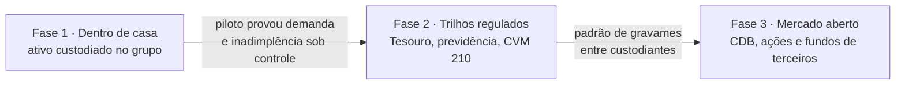

# Roadmap

A ideia cabe numa frase: **limite garantido como serviço**. Uma plataforma de Banking as
a Service oferece o gravame do investimento do cliente, que fica custodiado, e o limite
no cartão ou o empréstimo. O parceiro (fintech, varejista, carteira digital) é a entidade
tomadora de BaaS e só chama a API: quem concede o crédito e emite o cartão é a instituição
autorizada do grupo.

O caminho tem três fases, e cada uma só começa se a anterior funcionar. A ordem não é
de ambição, é de dependência: a primeira não precisa de ninguém de fora, a segunda usa
trilhos regulados que já existem, e a terceira depende de infraestrutura de mercado que
ainda não está pronta. **Nada aqui está integrado com a B3, o Selic ou a plataforma da
Res. Conjunta 12: o projeto simula o registro.**

## Fase 1: dentro de casa

O ativo que vira garantia está custodiado no próprio grupo da plataforma (um CDB de banco
parceiro ou um fundo DI da DTVM do grupo, por exemplo, na CTVM do grupo).

- **Por que começar aqui.** Não depende de contraparte externa nem de regulação nova. O
  gravame é registrado no mesmo dia, na B3 (aqui, simulado), a favor da SCD do grupo.
- **O que o código cobre.** O trilho casa, o limite do cartão só com o gravame
  registrado, a baixa em até 2 dias úteis, a conciliação e o empréstimo parcelado.
- **O que falta para ser produto.** Integração real com a infraestrutura de registro,
  com a processadora do cartão, com o produto de investimento e com a esteira de
  cobrança. Juros, multa e IOF do atraso. Contrato e termos validados pelo jurídico.

## Fase 2: trilhos regulados que já existem

O cliente usa como garantia um ativo que está fora do grupo, mas por um caminho que o
regulador já abriu. No código, cada trilho é simulado.

- **Previdência.** A Lei 14.652/2023 e a Resolução Conjunta CNSP/CMN nº 12/2024
  permitem dar em garantia o direito de resgate da previdência, só para empréstimo ou
  financiamento. A dependência é operacional: a entidade operadora informa em 2 dias
  úteis e não recusa pedido que siga a norma (arts. 4º, §1º, e 18), e a execução só vem
  após 90 dias de atraso, com avisos de 45 e de 10 dias (art. 12).
- **Tesouro Direto.** O TD Garantia, anunciado em novembro de 2024 por B3, Tesouro
  Nacional e Banco Central, permite ao investidor pessoa física dar títulos do Tesouro
  Direto em garantia. A dependência é o agente de custódia do cliente operar o serviço
  (ver [mercado.md](mercado.md), onde esse ponto está como a confirmar).
- **Portabilidade da CVM 210.** Ações, FIIs, ETFs e cotas de fundos mudam de instituição
  em 2, 5 ou até 9 dias úteis, e o gravame nasce na instituição de destino. CDB, LCI, LCA
  e Tesouro ficam fora, pelo entendimento corrente (interpretação).
- **O que o código já prevê.** O catálogo regulatório, a máquina do gravame e as portas
  `Contraparte` e `InfraestruturaDeRegistro`.
- **O que falta.** Um adaptador real por trilho, o preço de verdade no lugar do provedor
  fake e a validação do mapa regulatório pelo jurídico.

## Fase 3: mercado aberto

CDB, ações e cotas de fundo custodiados em qualquer instituição.

- **O que trava.** A lei manda constituir o gravame na registradora ou no depositário
  central onde o ativo está (Lei 12.810/2013, art. 26). Como os ativos estão espalhados,
  usar um deles como garantia em outra casa exige um padrão comum de gravames, e um
  custodiante disposto a cooperar com quem está levando o cliente dele. Não encontramos
  norma que obrigue o custodiante a registrar gravame para credor de outra instituição.
- **O que pode destravar.** A portabilidade de investimentos via Open Finance, que o
  Banco Central disse estar "no radar" (imprensa, mar/2026). O Drex chegou a prever a
  reconciliação de gravames, mas, segundo a imprensa, a plataforma de testes foi
  desligada: não encontramos norma nem data oficial, e **nada neste plano depende dele**.
- **Postura.** Não planejo nada que dependa disso antes de existir. A fase 3 é a razão
  pela qual a arquitetura tem a infraestrutura de registro atrás de uma interface, não uma
  promessa de prazo.

## O piloto

Pequeno de propósito, para responder uma pergunta só: os clientes de um parceiro que
não é banco usam isso, e pagam?

**Piloto recomendado: previdência como garantia**, de 6 a 8 semanas. É o trilho de fora
com norma clara e o único em que o ativo de outra instituição já tem caminho regulado
para o crédito.

| Semanas | O que entra |
|---|---|
| 1 e 2: diagnóstico | Custódia do Tesouro e de pessoa física; conexão a uma plataforma da Res. Conjunta 12; produtos de crédito; carteira de provisão; metodologia; manual de procedimentos (art. 17) e APIs da plataforma |
| 3 e 4: motor | Motor de elegibilidade e LTV (valor elegível e disponível, carência, prazo até o fim da acumulação, relação entre gravame e saldo devedor); haircut parametrizável, marcação diária, régua de 45, 10 e 90 dias, trilha de auditoria |
| 5 e 6: integração e painel | Sandbox ou simulador fiel à especificação da plataforma; painel de risco; caso de negócio com a carteira de um parceiro piloto, com dados reais autorizados ou sintéticos |
| 7 e 8 (opcional): extensão | Conector do TD Garantia e fluxo de portabilidade da CVM 210 de ações e FIIs para a CTVM do grupo |

Entregáveis: motor documentado, mapa regulatório validado pelo jurídico, painel e proposta
de piloto com um parceiro. Critério de sucesso: fluxo de ponta a ponta aprovado pelo
jurídico e pelo time de produto da plataforma.

Parâmetros do piloto:

| Parâmetro | Proposta |
|---|---|
| Parceiro | Um só, entidade tomadora de BaaS que já emite cartão pela plataforma |
| Garantia | Um produto por vez; o de LTV mais simples de explicar vem primeiro |
| Teto por cliente | Baixo no começo, configurado na política do parceiro |
| Teto da carteira | Um valor total para o parceiro, que o autorizador respeita |
| Liberação | Gradual: uma fração da base, depois o resto |
| Duração | O bastante para ver pelo menos dois ciclos completos de fatura |

Os dois tetos existem no código: `teto_limite_por_cliente` e `teto_limite_do_parceiro`
fazem parte da política de risco de cada parceiro.

### Métricas do piloto

| Métrica | O que responde | De onde sai |
|---|---|---|
| % da base que ativa | Existe demanda? | contas com gravame registrado ÷ contas elegíveis |
| Limite médio | Quanto o cliente topa reservar? | posição de limite das contas |
| Utilização do limite | O limite é usado ou fica parado? | dívida ÷ limite |
| Inadimplência | O cliente paga? | faturas em atraso ÷ faturas fechadas |
| % executada | Com que frequência a garantia é acionada? | eventos `garantia.executada` |
| Chamadas de margem | O LTV está bem calibrado? | eventos `chamada_de_margem` por situação |
| Tempo do pedido ao limite | A experiência é instantânea? | histograma de duração de `POST /garantias` |

As três últimas já saem da API: `lg_eventos_total` por tipo e
`lg_http_duracao_segundos` por rota, em `/metrics`.

### Critério para seguir para a fase 2

Não vou inventar número de corte: quem define é o time de risco, com a base real. O que
dá para dizer é o formato da decisão. Seguir se a ativação mostrar demanda, se a perda
depois da execução ficar baixa (a garantia reduz a perda, não a elimina: restam o risco do
emissor, de preço, de liquidez e de execução) e se a operação rodar sem intervenção manual.

## Como a plataforma ganharia dinheiro

- Receitas de BaaS e de cartão que já existem (emissão, processamento), sobre uma base
  que antes não tinha crédito.
- O produto de investimento que vira garantia: o dinheiro fica custodiado dentro de casa.
- Tarifa por operação e pela API de garantia.
- Estruturação ou administração do FIDC que compra os recebíveis.

Para o parceiro: intercâmbio das compras, um cliente que antes não tinha limite e
dinheiro que fica no app em vez de sair para o banco onde o limite estava.
