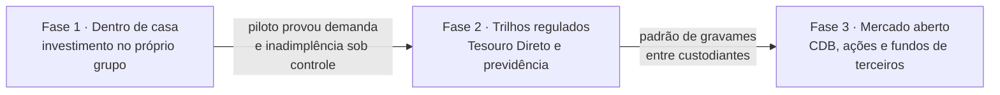

# Roadmap

A ideia cabe numa frase: **limite garantido como serviço**. Uma plataforma de Banking as
a Service guarda o investimento do cliente, registra a garantia e libera o limite no
cartão. O parceiro (fintech, varejista, carteira digital) só chama a API.

O caminho tem três fases, e cada uma só começa se a anterior funcionar. A ordem não é
de ambição, é de dependência: a primeira não precisa de ninguém de fora, a segunda usa
trilhos regulados que já existem, e a terceira depende de infraestrutura de mercado que
ainda não está pronta.

## Fase 1: dentro de casa

O investimento que vira garantia fica dentro do próprio grupo da plataforma (um CDB ou
uma conta remunerada do banco do grupo, por exemplo).

- **Por que começar aqui.** Não depende de custodiante externo, de integração com
  terceiros nem de regulação nova. Bloquear, marcar a mercado e executar são operações
  internas.
- **O que o código já cobre.** É exatamente o que está implementado: a custódia
  confirma o bloqueio na hora e a garantia já sai `bloqueada`.
- **O que falta para ser produto.** Integração com a processadora de cartão (o limite
  precisa chegar ao autorizador), com o produto de investimento e com a esteira de
  cobrança. Juros, multa e IOF do atraso. Contrato e termos validados pelo jurídico.

## Fase 2: trilhos regulados que já existem

O cliente usa como garantia um ativo que está fora do grupo, mas por um caminho que o
regulador já abriu.

- **Tesouro Direto.** O TD Garantia, anunciado em novembro de 2024 por B3, Tesouro
  Nacional e Banco Central, permite ao investidor pessoa física dar títulos do Tesouro
  Direto em garantia. A dependência aqui é a instituição credora estar habilitada no
  arranjo (ver [mercado.md](mercado.md), onde esse ponto está marcado como a confirmar).
- **Previdência.** A Lei 14.652/2023 e a Resolução Conjunta CNSP/CMN nº 12/2024
  permitem dar em garantia o direito de resgate de previdência aberta. A dependência é
  operacional: o processo passa pela seguradora.
- **O que o código já prevê.** O estado `pendente` da garantia e a porta `Custodiante`
  existem para isto. Quando a confirmação do gravame vem de fora, a garantia espera em
  `pendente`, sem gerar limite, até a custódia confirmar pela API administrativa. A
  política de risco já diferencia Tesouro Selic (95%) de prefixado e IPCA+ (80%).
- **O que falta.** Um adaptador de custódia por trilho, tratamento de recusa e de
  prazo estourado na confirmação, e o preço de verdade no lugar do provedor fake.

## Fase 3: mercado aberto

CDB, ações e cotas de fundo guardados em qualquer instituição.

- **O que trava.** A lei manda constituir o gravame na registradora ou no depositário
  central onde o ativo está (Lei 12.810/2013, art. 26). Como os ativos estão espalhados,
  usar um deles como garantia em outra casa exige um padrão comum de gravames, e um
  custodiante disposto a cooperar com quem está levando o cliente dele.
- **O que pode destravar.** A solução de reconciliação de gravames que o Banco Central
  passou a priorizar dentro do Drex. As datas ainda são incertas (ver
  [mercado.md](mercado.md)). A portabilidade de investimentos e o Open Finance ajudam
  no lado do consentimento e da visibilidade do ativo.
- **Postura.** Não planejo nada que dependa disso antes de existir. A fase 3 é a razão
  pela qual a arquitetura tem a custódia atrás de uma interface, não uma promessa de
  prazo.

## O piloto

Pequeno de propósito, para responder uma pergunta só: os clientes de um parceiro que
não é banco usam isso, e pagam?

| Parâmetro | Proposta |
|---|---|
| Parceiro | Um só, que já emite cartão pela plataforma |
| Garantia | Um produto, dentro de casa (o de LTV mais simples de explicar) |
| Teto por cliente | Baixo no começo, configurado na política do parceiro |
| Teto da carteira | Um valor total para o parceiro, que o autorizador respeita |
| Liberação | Gradual: uma fração da base, depois o resto |
| Duração | O bastante para ver pelo menos dois ciclos completos de fatura |

Os dois tetos existem no código: `teto_limite_por_cliente` e `teto_limite_do_parceiro`
fazem parte da política de risco de cada parceiro.

### Métricas do piloto

| Métrica | O que responde | De onde sai |
|---|---|---|
| % da base que ativa | Existe demanda? | contas com garantia bloqueada ÷ contas elegíveis |
| Limite médio | Quanto o cliente topa guardar? | posição de limite das contas |
| Utilização do limite | O limite é usado ou fica parado? | dívida ÷ limite |
| Inadimplência | O cliente paga? | faturas em atraso ÷ faturas fechadas |
| % executada | Com que frequência a garantia é acionada? | eventos `garantia.executada` |
| Chamadas de margem | O LTV está bem calibrado? | eventos `chamada_de_margem` por situação |
| Tempo do pedido ao limite | A experiência é instantânea? | histograma de duração de `POST /garantias` |

As três últimas já saem da API: `lg_eventos_total` por tipo e
`lg_http_duracao_segundos` por rota, em `/metrics`.

### Critério para seguir para a fase 2

Não vou inventar número de corte: quem define é o time de risco, com a base real. O que
dá para dizer é o formato da decisão. Seguir se a ativação mostrar demanda, se a perda
depois da execução ficar perto de zero (é o que se espera de crédito 100% garantido por
ativo líquido) e se a operação rodar sem intervenção manual.

## Como a plataforma ganharia dinheiro

- Receitas de BaaS e de cartão que já existem (emissão, processamento), sobre uma base
  que antes não tinha crédito.
- O produto de investimento que vira garantia: o dinheiro fica dentro de casa.
- Tarifa por operação e pela API de garantia.
- Estruturação ou administração do FIDC que compra os recebíveis.

Para o parceiro: intercâmbio das compras, um cliente que antes não tinha limite e
dinheiro que fica no app em vez de sair para o banco onde o limite estava.
